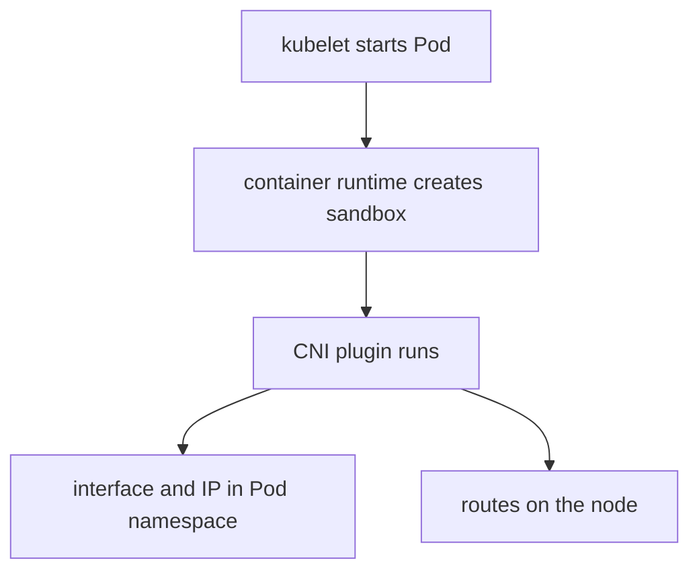

# Pod Addresses And Network Implementation

A Pod IP address is assigned when the Pod starts and is released when the Pod is deleted. Every request between Pods uses these addresses, so you need to know who assigns them, what the containers of one Pod share and what carries a packet from one node to another. This part gives you those facts and lets you read them from a running cluster.

## Learning objectives

- Explain which network resources the containers of one Pod share.
- Name the component that assigns Pod addresses and the component that moves traffic between nodes.
- Read the address, node and range of a Pod with kubectl.
- Reach a Pod by its IP address from a Pod in another namespace.

## Before you start

You need the playground from the module page. A **namespace** groups objects; it does not separate the network. A **Pod** is the smallest unit that Kubernetes runs and holds one or more containers.

<!-- astrona:playground:renew -->

Start with the addresses. Run the command, then look at the `IP` and `NODE` columns:

```sh
kubectl get pods -A -o wide
```

Every application Pod has its own IP, and the Pods spread over the two nodes. Pods on the same node and Pods on different nodes show addresses from the same cluster-wide scheme. Now send a request from the `drifter` client in the `outpost` namespace to the `scout` Pod in `starfleet`. First read the address of `scout`:

```sh
kubectl -n starfleet get pod -l app=scout -o jsonpath='{.items[0].status.podIP}{"\n"}'
```

Replace `<SCOUT_IP>` with that address and request port 9898, the port of the `scout` application:

```sh
kubectl -n outpost exec deploy/drifter -- curl -s --max-time 3 http://<SCOUT_IP>:9898/
```

The request works although the two Pods are in different namespaces and, possibly, on different nodes. This is the Kubernetes network model in practice: a Pod reaches another Pod by its IP address, without address translation, regardless of namespace or node.

## What the containers of one Pod share

A Pod gets one network namespace. A **network namespace** is a Linux kernel object that holds a set of network interfaces, a routing table, firewall rules and the list of open ports. All containers in the Pod join this namespace. Three consequences follow.

First, the containers share one IP address. A client in any container reaches a server in another container of the same Pod through `127.0.0.1`. Second, the containers share the port space, so two containers in one Pod cannot listen on the same port. Third, the address belongs to the Pod and not to a container, so a container restart keeps the Pod IP but a new Pod gets a new IP.

An empty container, named `pause` in most runtimes, is started first and owns the namespace. The other containers join it. That is why the network stays up while a single application container restarts.

## Who assigns the address

When the kubelet on a node starts a Pod, it asks the container runtime to create the sandbox, which is the empty container that owns the network namespace. The runtime then calls a **Container Network Interface (CNI) plugin**. CNI is a specification for programs that configure the network interface of a container. The plugin creates a virtual network interface pair, places one end inside the Pod namespace, assigns an address from the range of the node, and adds routes.

Each node gets a slice of the cluster Pod range. You can read the slice of each node:

```sh
kubectl get nodes -o custom-columns=NAME:.metadata.name,PODCIDR:.spec.podCIDR
```

The `PODCIDR` column shows the range from which the plugin on that node hands out addresses. Some plugins manage address ranges themselves and leave this field empty. In that case the column is blank, and the plugin documentation tells where the ranges live. kind clusters normally fill it.



The kubelet starts the Pod, and the CNI plugin creates the interface, the address and the routes that make it reachable.

## How packets cross nodes

Two Pods on the same node are joined through a virtual bridge or direct routes on that node. For Pods on different nodes, the plugin must carry packets between the nodes. There are two common designs. In a routed design, each node knows which node owns each Pod range and sends packets there directly. In an encapsulated design, the plugin wraps the Pod packet in an outer packet addressed to the other node, and the other node unwraps it. Encapsulation needs no knowledge of the underlying network, but the outer header makes each packet larger, so the maximum transmission unit (MTU) of the Pod interface must be smaller than that of the node.

The cluster does not choose the design for you. Kubernetes only requires the result: all Pods can reach all Pods, and all nodes can reach all Pods, without address translation. The plugin that you install decides how this is done. kind installs a simple plugin that routes between its node containers, and the playground can run another plugin when a lesson needs one.

## What the network plugin does not do

Three things are separate from the Pod network and often mistaken for it. Service addresses are virtual and are implemented by the proxy component of each node. Name resolution is done by the cluster DNS server. Traffic rules are enforced by the plugin only when the plugin supports NetworkPolicy. A cluster can have a healthy Pod network and still fail in any of the three.

You can see the Pod network and the Service network side by side. Read the `scout` Service address and compare it with the Pod addresses:

```sh
kubectl -n starfleet get service scout -o wide
kubectl -n starfleet get pods -o wide
```

The ClusterIP of the Service is in a different range from every Pod address, and no interface in the cluster owns it. Only the forwarding rules on the nodes know what to do with a packet for that address.

## Reading the result

You learned that a Pod IP is assigned by the CNI plugin when the Pod starts, that all containers of the Pod share it, and that the plugin is responsible for reaching Pods on other nodes. The next question in any failing request is whether the destination address is reached at all. A request by Pod IP answers that question without a Service or a name in the way, which is why you test it first.

## Common pitfalls

> [!WARNING]
> Do not store a Pod IP in a configuration file: the address changes whenever the Pod is replaced. A namespace is not a network boundary, so a Pod in another namespace can reach your Pod unless a NetworkPolicy blocks it. Installing a CNI plugin does not by itself enforce NetworkPolicy; that depends on the plugin.
