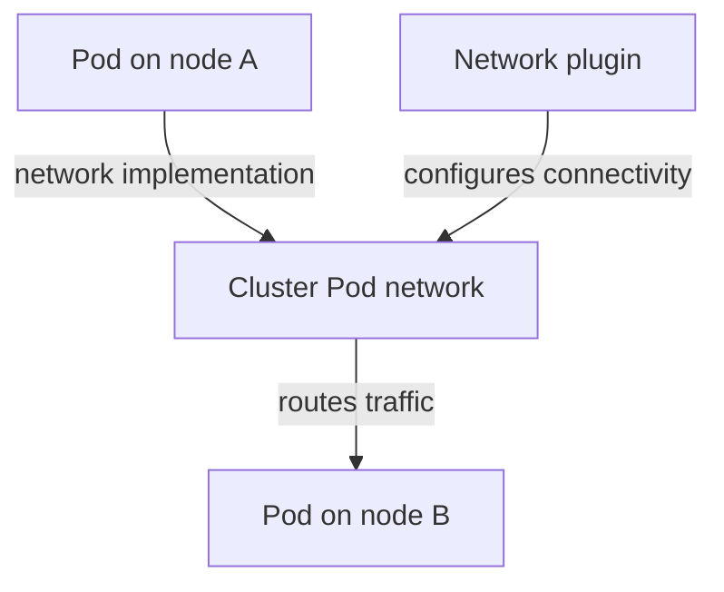
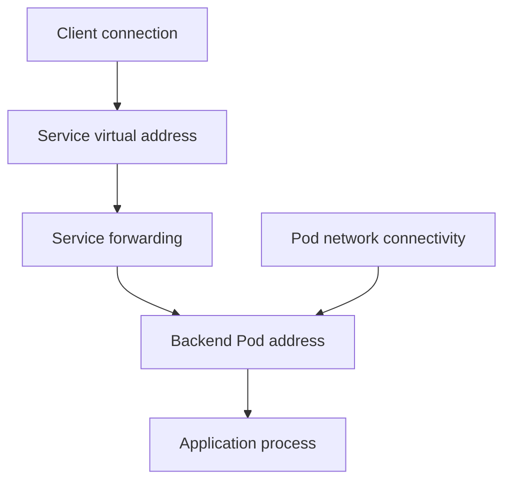

# Pod Addresses And Network Implementation

A Pod IP changes when the application is replaced, but the Service still provides the same access point. Pod addressing and Service forwarding are different network responsibilities. Understanding both helps localize a request failure.

## Learning objectives

- Explain Pod address and shared-network behavior.
- Identify network implementation responsibilities.
- Distinguish name resolution from destination connectivity.

## Before you start

This chapter is standalone reading material; no running cluster or installed tools are required. A Pod is the Kubernetes unit for running one or more containers, and a namespace groups namespaced objects. Treat the worked configurations as teaching examples rather than recorded observations from a provisioned environment.

## Responsible components and behavior

The `shuttle` Pod sends a request to the `probe` Pod on another node. Kubernetes gives Pods network identities so applications can communicate without needing to know which node hosts each process. Containers inside a normal Pod share its network namespace and can communicate through the local loopback address.

The Kubernetes network model expects Pod-to-Pod communication across nodes without an application needing to translate its Pod address. The network implementation makes that model work through routing, encapsulation or other mechanisms. The details depend on the plugin, infrastructure and configured policy.

The Container Network Interface (CNI) defines an interface used to configure container networking. A CNI plugin helps connect Pod network namespaces and allocate addresses. A network implementation may also enforce policy or implement Service forwarding, but these capabilities are not guaranteed merely because a plugin supports CNI.

A Pod's address is different from a node address. Replacement can give an application a new Pod address. Applications therefore should not treat one Pod address as a permanent service location. A Service supplies a stable access abstraction for selected backends while individual Pods change.

Cross-node communication depends on the configured network implementation, not on the scheduler forwarding packets.

Connectivity also depends on policy and application listeners. Successful Pod placement does not prove that its port is open or its address is reachable from a particular source. For a communication failure, distinguish addressing, route implementation, traffic policy and the process listening on the destination.

## Addressing Across Node Boundaries

Consider `shuttle` on node A and `probe` on node B. The client process sends a packet using its Pod network namespace. The configured network implementation moves that packet across the required host and infrastructure boundaries, then delivers it to the destination Pod network namespace. The application does not ask the scheduler to relay each packet.

An implementation can route directly between Pod address ranges or encapsulate traffic for transport across the underlying network. Encapsulation wraps the original packet in another packet; routing determines how the destination is reached through the network. The choice affects operational details and overhead, but the application-facing goal remains compatible Pod communication.

Infrastructure still matters. Host routing, firewall rules, address allocation and permitted packet sizes can affect whether the plugin's design works. A valid Pod address is not proof that every node path is healthy. A failure limited to cross-node traffic suggests a different boundary from a failure between two containers sharing one Pod.

## Pod Networking And Service Networking

A Pod address identifies an instance. A Service address identifies a stable access abstraction that can direct clients to several instances. The forwarding component must translate or otherwise implement that access pattern according to its design. A network plugin may provide both Pod connectivity and Service behavior, but the responsibilities remain conceptually distinct.

Replacement can change a Pod address while the Service address stays the same. This helps clients avoid tracking every lifecycle event. Long-lived connections can still point to a failed backend, so applications need appropriate reconnection and safe retries. Stable discovery does not make every established connection immortal.

When explaining a failure, identify whether the client uses an instance address or a Service abstraction, whether the path crosses nodes and which component implements that path. Then consider traffic policy and the listener. These details turn a broad “networking is broken” symptom into a bounded question.

## Work through the decision

Internet Protocol (IP) addresses identify network destinations. A Pod receives its own network context and address through the cluster's network arrangement. The Container Network Interface (CNI) integration participates in connecting Pod networking. Service forwarding separately maps a Service address to backend addresses using the implementation installed in the cluster.

Some platforms replace parts of the usual forwarding arrangement with another implementation. Therefore a correct explanation names the responsibility rather than assuming every cluster uses the same daemon or rule format. Direct Pod reachability tests one path; Service reachability includes selection and virtual-address forwarding too. A result from one cannot automatically establish the other.

Service forwarding selects a destination whose underlying Pod network must also provide connectivity.

You can now distinguish network responsibilities and avoid hard-coding replaceable Pod addresses. Investigation should compare the actual caller path, selected endpoint and network implementation before changing cluster-wide settings.

## Common pitfalls

> [!WARNING]
> Supporting CNI does not guarantee NetworkPolicy enforcement. Pod addresses can change, and the scheduler does not implement packet forwarding.
