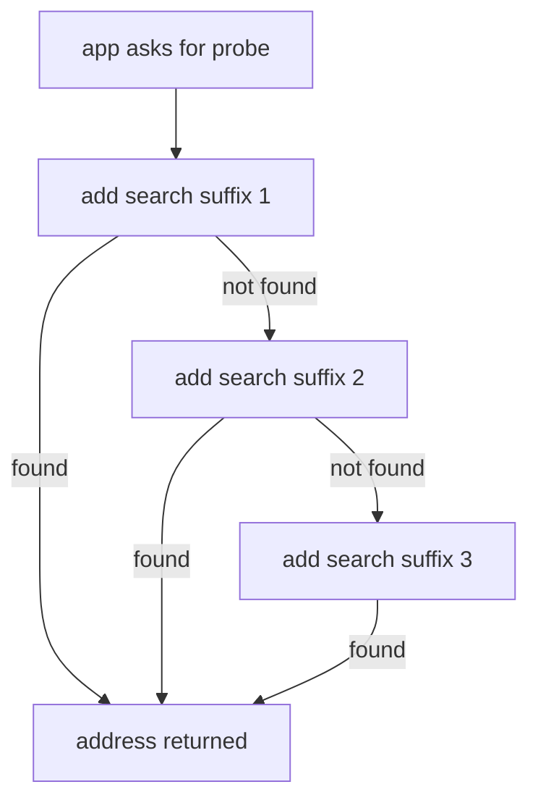

# DNS And Service Discovery

Applications connect to names such as `probe`, not to addresses, because Pod addresses change and Service addresses are easier to configure as names. Before any connection starts, the client has to turn the name into an address. This part shows where a Pod gets its resolver settings, how a short name is expanded and how to tell a name failure from a connection failure.

## Learning objectives

- Read the resolver settings of a Pod and explain each line.
- Explain how the search list and `ndots` expand a short name.
- Resolve a Service in the same namespace and in another namespace.
- Tell a resolution failure from a connection failure by the way the client fails.

## Before you start

You need the playground and the idea of a **Service**: a stable virtual address and name in front of a set of Pods. **DNS** (Domain Name System) is the protocol that maps names to addresses. In a cluster, a DNS server runs as Pods in the `kube-system` namespace and answers for all Service names.

<!-- astrona:playground:renew -->

Read the resolver file of the `shuttle` client:

```sh
kubectl -n starfleet exec deploy/shuttle -- cat /etc/resolv.conf
```

The file has three kinds of line. The `nameserver` line holds one address, which is the ClusterIP of the cluster DNS Service. The `search` line lists three domain suffixes, the first of which starts with the namespace of the Pod. The `options` line sets `ndots:5`. The kubelet writes this file when it creates the Pod, based on the DNS policy of the Pod and the settings of the cluster.

Compare the `nameserver` address with the cluster DNS Service:

```sh
kubectl -n kube-system get service kube-dns
```

The ClusterIP is the same. In every Pod with the default DNS policy, the resolver sends its questions to that Service, and the Service forwards them to the CoreDNS Pods.

## How a short name becomes an address

When an application asks for `probe`, the resolver library checks the `ndots` option. The number is the minimum count of dots a name needs before the resolver tries it as an absolute name first. `probe` has no dots and `ndots` is 5, so the library appends each search suffix in order and asks for `probe.starfleet.svc.cluster.local`, then `probe.svc.cluster.local`, then `probe.cluster.local`, and finally `probe` alone. The first answer that is not a "name does not exist" answer wins.

This is why one short name works inside the same namespace. The first suffix is the namespace of the Pod, so `probe` finds the Service `probe` in `starfleet`. The same name from the `outpost` namespace finds the Service `probe` in `outpost`, which is a different Service that happens to have the same name.



The resolver tries each suffix in order and stops at the first name that exists.

Test the three forms of a Service name from `shuttle`. Each request goes to a different Service name that points to a Service:

```sh
kubectl -n starfleet exec deploy/shuttle -- curl -s --max-time 3 -o /dev/null -w '%{http_code}\n' http://probe/
kubectl -n starfleet exec deploy/shuttle -- curl -s --max-time 3 -o /dev/null -w '%{http_code}\n' http://probe.outpost/
kubectl -n starfleet exec deploy/shuttle -- curl -s --max-time 3 -o /dev/null -w '%{http_code}\n' http://probe.starfleet.svc.cluster.local/
```

The first request reaches `probe` in `starfleet`. The second adds the namespace and reaches the `probe` Service in `outpost`, because `probe.outpost` is expanded with the second search suffix. The third is the fully qualified name, which names the Service, the namespace and the cluster domain, so no search is needed. Each request prints the HTTP status code.

## Two failures that look alike

A name that does not exist and a name that exists but whose server is not reachable fail in different ways. Ask for a Service that does not exist and read the exit code:

```sh
kubectl -n starfleet exec deploy/shuttle -- curl -s --max-time 3 http://no-such-service/
echo "exit code: $?"
```

curl exits with code 6, which means it could not resolve the host. The failure happened before any connection: the DNS answer was "no such name". Now compare it with a request to a name that resolves but whose port has no listener, or an address that does not answer. Those end with code 7, a refused connection, or code 28, a timeout. The exit code therefore tells you which half of the request failed: 6 is the name, 7 and 28 are the connection.

The `echo` runs on your machine after `kubectl exec` returns and prints the exit code that kubectl passes through from curl.

## Where Service discovery gets its data

The DNS server does not keep its own list of Services. CoreDNS watches the Kubernetes API for Services and for Pods and answers from that data. A new Service is resolvable within seconds, with no change to any client. A Service in the `outpost` namespace is answered the same way for every client; the only thing that changes with the client is the search list, which begins with the client's own namespace.

Services also publish environment variables to the Pods created after them, such as `PROBE_SERVICE_HOST`. These are fixed at Pod start and do not change when a Service is recreated. DNS is the supported way to find a Service because it always reflects the current object.

## Reading the result

You now know that a request has two phases: the name becomes an address, and then a connection is made to that address. The resolver settings come from the kubelet, the search list adds suffixes to short names, and exit code 6 from curl points at the name while codes 7 and 28 point at the connection. When a Service name fails, check the namespace the client is in before suspecting the DNS server.

## Common pitfalls

> [!WARNING]
> A short name resolves differently in every namespace, so a name that works from one namespace can fail or reach another Service from a different one. Use `service.namespace` or the fully qualified name when the client is not in the namespace of the Service. A name that resolves only proves that the Service exists; it does not prove that the Service has ready backends.
