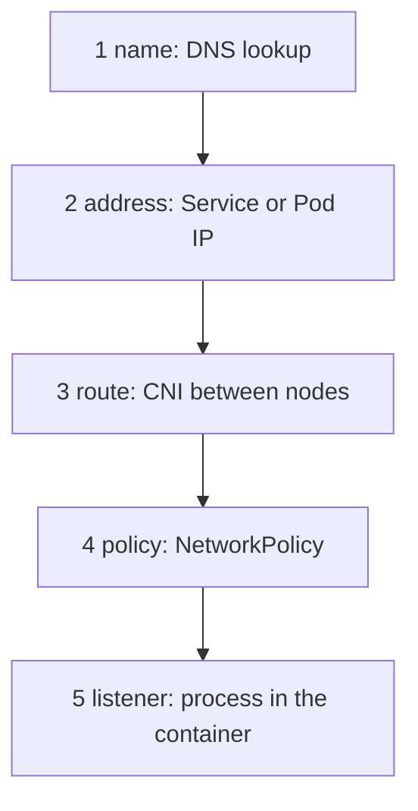

# A Triage Method And The Tools

When the `shuttle` Pod cannot reach the `probe` Pod, the message on the screen is usually a single line such as `curl: (28) Connection timed out`. That line is a symptom, not a cause. This part builds a short order of checks that turns a symptom into a cause, and then shows the tools that run each check.

## The layers a request passes through

A request from a client Pod to a server Pod passes through five layers. Each layer can fail on its own, and a test at one layer says nothing about the layers above it.



The diagram lists the layers in the order a packet meets them: the name is resolved to an address, the packet is routed to the node of the destination, a policy may drop it, and finally a process must accept the connection.

A good triage tests from the bottom up. Start with the address of the Pod, because that removes the name and the Service from the picture. If the Pod IP works, the route, the policy and the listener are fine for that client, and the fault is in the Service or the name. If the Pod IP fails, the Service and the name are not the problem yet.

## Read the result of a connection

The way a connection attempt ends tells you the layer. A client sends a TCP SYN packet and waits for an answer. There are three different endings.

A **timeout** means no answer came back. Something dropped the packet silently. The usual causes are a NetworkPolicy that does not allow the client, a route problem between nodes, or a wrong IP address that nobody owns. `curl` reports this as exit code 28 when you set `--max-time`.

A **refused connection** means the destination host answered with a TCP reset because nothing listens on that port. The route and the policy are fine. The cause is a wrong port, a server that has not started, or a server bound to another address. `curl` reports this as exit code 7.

A **reset or an empty reply** means a connection was made and then closed. A process accepted it and ended it, or a proxy in the path did. The cause is in the application or in a proxy, not in the network.

An HTTP status such as 503 means the whole network path worked and a server answered. That is a different class of problem: the request reached a program.

## Start from the Pod IP

First list the Pods with their addresses and nodes. The `-o wide` option adds the `IP` and `NODE` columns:

<!-- astrona:playground:renew -->

```sh
kubectl -n starfleet get pods -o wide
```

Pick the `probe` Pod and read its IP from the `IP` column. Then request it directly from the `shuttle` client. The `probe` server listens on port 8080. Replace `<PROBE_IP>` with the address you read:

```sh
kubectl -n starfleet exec deploy/shuttle -- curl -s --max-time 3 -o /dev/null -w "%{http_code}\n" http://<PROBE_IP>:8080/
```

An answer of `200` proves the address, the route, the policy and the listener for this one client and this one port. Now test the Service, which adds the name and the forwarding of the Service:

```sh
kubectl -n starfleet exec deploy/shuttle -- curl -s --max-time 3 -o /dev/null -w "%{http_code}\n" http://probe/
```

If the Pod IP works and the Service does not, the fault sits between the Service and the Pods. The next check is the list of EndpointSlices, which shows the addresses that the Service selected.

## Look at what a Service selected

The EndpointSlice controller in the control plane watches Pods and Services. For every Service with a selector it writes one or more EndpointSlice objects. Each slice lists the ready Pod addresses and ports. A Service with no addresses in its slices has no backends, so every request to it ends in a refusal or a timeout, depending on the proxy.

```sh
kubectl -n starfleet get endpointslices -l kubernetes.io/service-name=probe
```

Read the `ENDPOINTS` column. It must list the Pod IPs and the port. An empty column means that no ready Pod matches the selector. Two causes are common: the selector does not match the Pod labels, or the Pods are not ready.

## Debug inside the network of a Pod

Many images have no shell and no `curl`. You cannot install tools inside a running container without changing the Pod. `kubectl debug` solves this by adding an **ephemeral container** to an existing Pod. An ephemeral container is a temporary container that shares the Pod's network namespace and is added after the Pod started. It never restarts and it is not part of the Pod template.

Read the name of the `scout` Pod with `kubectl -n starfleet get pods -l app=scout`. Then add a debug container to that Pod. Replace `<SCOUT_POD>` with the name. The `--target` option also shares the process namespace of the named container, and `-it` attaches your terminal:

```sh
kubectl -n starfleet debug -it <SCOUT_POD> --image=busybox:1.37.0 --target=scout -- sh
```

Inside the shell, the Pod's own network is visible. The command `wget -q -O- -T 3 http://127.0.0.1:9898/` tests the listener from inside the Pod, and `netstat -ltn` lists the ports in the Pod that are in the LISTEN state. If a port is missing from the list, no process listens on it. Leave the shell with `exit`.

A second form copies a Pod instead of changing it. `kubectl debug <pod> --copy-to=<name> --container=<container> --image=<image>` creates a new Pod with the same spec and a different image or command. Use the copy when you must change the command of a crashing container without touching the original.

## Reading events and logs

Two more sources complete the picture. The first is the list of events for the Pod. It shows scheduling, image pull and probe failures. The second is the container log, which shows whether the server started and on which address it reported to listen.

```sh
kubectl -n starfleet describe pod -l app=probe
kubectl -n starfleet logs deploy/probe
```

In the `describe` output, look at the `Conditions` block and the `Events` block at the end. A `Ready` condition of `False` explains why a Pod is not in an EndpointSlice.

You now have an order of checks and the tools for each step: Pod IP first, then the Service, then the EndpointSlices, then a debug container, then events and logs. Each tool answers one question about one layer. The next question is which concrete mistakes produce which result at the client.

## Common pitfalls

> [!WARNING]
> A test from your own machine is not a test from a Pod: different network, different policy. Always test from a client Pod in the namespace that has the problem. A successful request from `shuttle` does not prove that `drifter` in another namespace can connect, because a policy can allow one and drop the other. Do not edit the Service until the Pod IP test has told you the Pod itself works.
