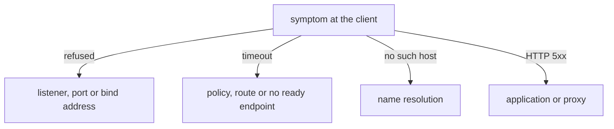

# Common Failure Causes

Knowing the order of checks is only half of the work. The other half is knowing what each concrete mistake looks like from the client side, so that a timeout or a refusal points to one cause. This part takes the mistakes that appear most often in clusters and shows how each one ends at the client.

## A server that listens only on the loopback address

Every Pod has two kinds of addresses: the loopback address `127.0.0.1`, which exists only inside the Pod, and the Pod IP, which other Pods can reach. A server process chooses the addresses it listens on when it starts. A server bound to `127.0.0.1` accepts connections from inside its own Pod and refuses everything that arrives on the Pod IP.

The `relay` Deployment in the playground runs an NGINX server configured with `listen 127.0.0.1:8080;`. Its Service is called `relay` and forwards port 80 to port 8080. Request the Service from `shuttle`:

<!-- astrona:playground:renew -->

```sh
kubectl -n starfleet exec deploy/shuttle -- curl -s --max-time 3 http://relay/
```

The command fails with a refused connection (exit code 7), not with a timeout. That tells you the packet arrived at the Pod and the network stack of the Pod answered with a reset. The route, the Service and the policy are fine. EndpointSlices still list an address for `relay`, because this Deployment has no readiness probe, so the kubelet marks the Pod ready as soon as the container runs. This shows that a listed endpoint proves nothing about the listener.

To prove the cause, test the listener from inside the Pod. Read the Pod name with `kubectl -n starfleet get pods -l app=relay`, then run the check in the container. Replace `<RELAY_POD>` with that name:

```sh
kubectl -n starfleet exec <RELAY_POD> -- wget -q -O- -T 3 http://127.0.0.1:8080/
```

This works. The same server answers on the loopback address and refuses on the Pod IP, so the only fault is the bind address. The fix is in the server configuration: the `listen` directive must name port 8080 without an address, which means all addresses, or name `0.0.0.0`.

## A Service whose targetPort does not match the container

A Service has two port numbers that learners often mix up. `port` is the port that clients use on the Service address. `targetPort` is the port on the Pod that the traffic is forwarded to. If `targetPort` names a port where no process listens, every request is forwarded to a closed port.

The `beacon` Deployment runs a `podinfo` server on port 9898. Its Service forwards to `targetPort: 8080`. Compare the two sides of the Service:

```sh
kubectl -n starfleet get service beacon -o jsonpath='{.spec.ports[*].targetPort}{"\n"}'
kubectl -n starfleet get deployment beacon -o jsonpath='{.spec.template.spec.containers[0].ports[*].containerPort}{"\n"}'
```

The first command prints 8080 and the second prints 9898. A request to `http://beacon/` from `shuttle` ends in a refusal. The EndpointSlice is not empty and shows port 8080, so the controller did its work; it copies the Service's target port into the slice and does not check the container. The fix is to set `targetPort` to the real container port. A named port is safer, because the Service follows the name even when the number changes: `targetPort: http` works when the container declares `name: http`.

## A Pod that is not ready

A Service sends traffic only to Pods whose `Ready` condition is true. The kubelet sets this condition from the readiness probe. A Pod that fails its probe stays in the Deployment but leaves the EndpointSlice, so the Service has no backend for it.

The `hold` Deployment has a readiness probe that requests a path the server does not serve. Look at the Pods and at the EndpointSlices of its Service:

```sh
kubectl -n starfleet get pods -l app=hold
kubectl -n starfleet get endpointslices -l kubernetes.io/service-name=hold
```

The Pod shows `0/1` in the `READY` column while its status is `Running`. The EndpointSlice has no ready address. A client that requests `http://hold/` waits until the timeout, because the Service has no backend to forward to. `kubectl describe pod` shows the failed probe in the events. The Pod is healthy in the sense that the process runs; the network path is closed because the readiness check says the Pod must not receive traffic.

## A selector that matches no Pod

A Service finds its Pods through `spec.selector`, which must equal labels in the Pod template exactly. A typo such as `app: probes` selects nothing. The Service exists, has a ClusterIP and answers DNS, but its EndpointSlice is empty. Compare the selector with the labels using `kubectl get pods --show-labels` and the Service's `spec.selector`. This cause looks like the not-ready cause at the client, and the way to tell them apart is the Pod list: in the selector case no Pod is listed with the expected label at all.

## A NetworkPolicy drop

A NetworkPolicy drops traffic silently. The client sees a timeout, because the network plugin discards the packet without an answer. This is the main difference from a closed port, which answers with a refusal. When every layer below the policy looks fine and the symptom is a timeout, list the policies in the namespace of the destination with `kubectl -n starfleet get networkpolicy`. A policy matters only when its `podSelector` selects the destination Pod, and it matters only when the cluster runs a network plugin that enforces policies.

## The network between nodes or the plugin itself

Two failures sit below all the layers above. If a Pod stays in `ContainerCreating` and its events mention the network plugin, the kubelet could not set up the Pod network, usually because the plugin is not installed or not ready on that node. If Pod-to-Pod requests work on one node and time out only between two nodes, the route or tunnel between the nodes has a problem: a host firewall, a wrong route or a packet size problem. Test it by placing a client and a server on different nodes with `-o wide` and repeating the request by Pod IP.



The diagram maps the four client symptoms to the layer you should test first.

Each cause shows itself in a different way: a refusal points at the listener, a timeout points at policy, route or an empty Service, and a name error points at DNS. With this mapping, a failing request stops being a general network problem and becomes one named layer to check. What remains is practice in reading the signals on real workloads.

## How to practise these causes

Each cause above has a matching workload in the playground, and each needs the same three steps. First, send one bounded request from `shuttle` and write down how it ended. Second, use the table of symptoms in the diagram to pick the layer. Third, read the one object that proves the cause: the server configuration for a bind address, the Service and container ports for a port mismatch, the Pod `READY` column for a probe, or the selector and labels for an empty Service.

Do this before changing anything. A change without a proven cause often hides the fault instead of removing it. For example, setting a Service `targetPort` to a port that happens to answer can work today and break when the container changes its port tomorrow.

## Common pitfalls

> [!WARNING]
> A full `Running` status does not mean a Pod can receive traffic: check the `READY` column and the EndpointSlices. A refused connection never comes from a NetworkPolicy; a policy drop is a timeout. Do not widen a policy or open the node firewall to test a theory; test each layer with a bounded request and change one thing at a time.
