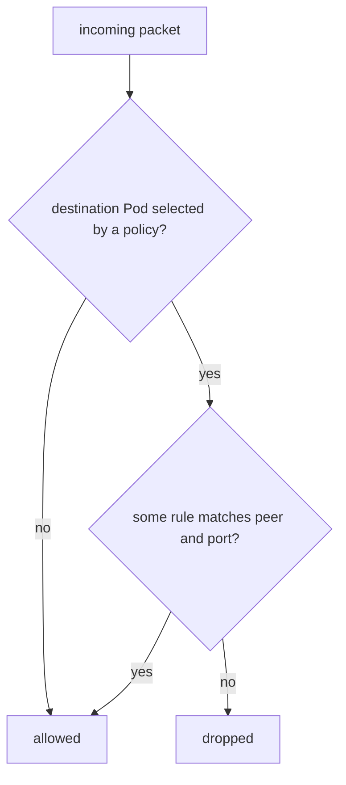

# Traffic Isolation And Allowed Peers

A NetworkPolicy is a list of allowed connections for a chosen group of Pods. Everything not on the list is dropped for those Pods. This part shows how the policy chooses its Pods, how it names the allowed peers and what happens to Pods that no policy selects.

## Learning objectives

- Explain which Pods a policy isolates and for which direction.
- Write an ingress rule that allows one peer on one port.
- Predict the result when selectors are combined in one entry and when they are listed separately.
- Read a policy with `kubectl describe`.

## Before you start

A **NetworkPolicy** is a namespaced object of API group `networking.k8s.io/v1`. It is enforced by the network plugin, not by the API server, so the plugin must support it. The playground uses Calico, which does.

<!-- astrona:playground:renew -->

Start by proving that nothing is restricted. Both client Pods can request the `bridge` application on port 80:

```sh
kubectl -n starfleet exec deploy/shuttle -- curl -s --max-time 3 -o /dev/null -w '%{http_code}\n' http://bridge/
kubectl -n outpost exec deploy/drifter -- curl -s --max-time 3 -o /dev/null -w '%{http_code}\n' http://bridge.starfleet/
```

Both requests return 200. No policy selects the `bridge` Pod, so it is not isolated and accepts every connection.

## What a policy selects

The field `spec.podSelector` chooses the Pods the policy protects, by label, in the namespace of the policy. An empty selector `{}` chooses every Pod in the namespace. The field `spec.policyTypes` lists the directions the policy covers: `Ingress`, `Egress` or both. A Pod is **isolated for ingress** when at least one policy selects it and lists `Ingress`. From that moment the Pod accepts only the connections that the ingress rules of all selecting policies allow. The same applies to egress with the `Egress` type.

Two rules follow from this. Policies only allow traffic. There is no deny rule, so isolation comes from being selected and the allowed list comes from the union of all rules. Adding a second policy for a Pod that is already isolated can only open more traffic, never close it.

## One policy that allows one peer

Save this as `bridge-allow-shuttle.yaml`. It selects the `bridge` Pods and allows ingress from Pods labelled `app: shuttle` in the same namespace, on TCP port 80:

```yaml
apiVersion: networking.k8s.io/v1
kind: NetworkPolicy
metadata:
  name: bridge-allow-shuttle
  namespace: starfleet
spec:
  podSelector:
    matchLabels:
      app: bridge
  policyTypes:
    - Ingress
  ingress:
    - from:
        - podSelector:
            matchLabels:
              app: shuttle
      ports:
        - protocol: TCP
          port: 80
```

Apply it:

```sh
kubectl apply -f bridge-allow-shuttle.yaml
```

Then check the two clients again with the commands above. The request from `shuttle` still returns 200, and the request from `drifter` waits until curl gives up with a timeout. The packet is dropped without an answer, and that silence is how a policy drop looks to the client.

## Three kinds of peer

An ingress rule has a `from` list. Each entry in the list is one peer and uses exactly one of three forms or a combination of the first two:

- `podSelector` matches Pods by label in the namespace of the policy.
- `namespaceSelector` matches all Pods in the namespaces whose labels match. Every namespace has the label `kubernetes.io/metadata.name` with its own name, which makes selection by name possible.
- `ipBlock` matches a range of addresses with `cidr` and optional `except` ranges. It is meant for addresses outside the cluster, because Pod addresses change.

The `ports` list restricts the destination ports. Each entry has a `protocol` (TCP by default) and a `port`, which is a number or a named container port. A rule with no `ports` allows all ports.

## The difference between one entry and two

Look at the two lists below. They differ by one dash:

```yaml
- from:
    - namespaceSelector:
        matchLabels:
          kubernetes.io/metadata.name: outpost
      podSelector:
        matchLabels:
          app: drifter
```

```yaml
- from:
    - namespaceSelector:
        matchLabels:
          kubernetes.io/metadata.name: outpost
    - podSelector:
        matchLabels:
          app: drifter
```

The first list has one entry with two selectors, and both must match: Pods labelled `app: drifter` that are in the namespace `outpost`. The second has two entries, and either may match: every Pod in `outpost`, or any Pod labelled `app: drifter` in the policy namespace. The second form usually allows far more than intended.



A Pod that no policy selects accepts everything; a selected Pod accepts only what a rule allows.

## Reading a policy back

Ask the API server how it understood the policy:

```sh
kubectl -n starfleet describe networkpolicy bridge-allow-shuttle
```

The output lists the Pods the policy applies to, the allowed ingress sources and the policy types. Compare it with what you meant to write. A missing `from` entry or a wrong label shows up here before it shows up as a timeout.

## Reading the result

You have seen that isolation starts with the first policy that selects a Pod, that rules only add allowed traffic and that peers are chosen by Pod labels, namespace labels or address ranges. The result of a combined selector depends on the list structure, so read the dashes. Egress follows the same model and has one extra problem, the name lookup, which is the subject of the next steps in your practice.

## Common pitfalls

> [!WARNING]
> A policy that selects Pods does nothing if the network plugin does not enforce policies, and no error tells you so. A `podSelector` in a `from` entry matches only Pods in the namespace of the policy unless a `namespaceSelector` is in the same entry. Do not use `ipBlock` for Pod addresses, because Pods get new addresses.
