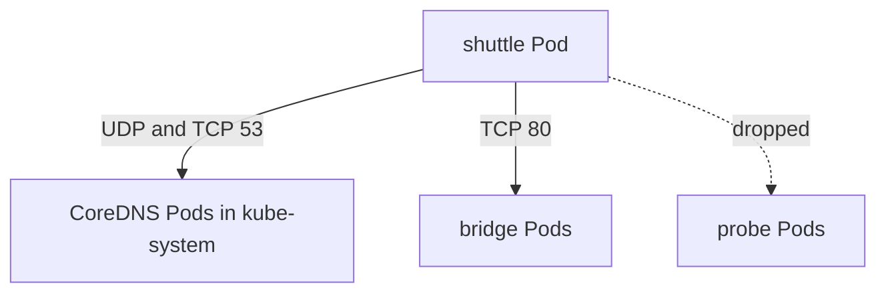

# NetworkPolicy And Allowed Connections

Ingress policy protects a server. Egress policy limits what a client may open. Egress is harder to write because a client usually needs a second destination that its author did not think about: the cluster DNS server. This part shows how egress rules work, why DNS must be allowed explicitly and how the network plugin treats replies and established connections.

## Learning objectives

- Write an egress policy that allows one destination and DNS.
- Explain why a client that is isolated for egress cannot resolve names unless DNS is allowed.
- Explain how replies to allowed connections are handled.
- Describe what a network plugin must do for a policy to have any effect.

## Before you start

You need the ingress model: a Pod is isolated for a direction when a policy selects it for that direction, and rules only allow traffic. In an **egress** rule the peers are written under `to` instead of `from`, and they describe where the selected Pods may connect.

<!-- astrona:playground:renew -->

First check that the client works with no egress restriction:

```sh
kubectl -n starfleet exec deploy/shuttle -- curl -s --max-time 3 -o /dev/null -w '%{http_code}\n' http://bridge/
kubectl -n starfleet exec deploy/shuttle -- curl -s --max-time 3 -o /dev/null -w '%{http_code}\n' http://probe/
```

Both requests return 200. The client can reach any Service, and it uses the cluster DNS server to find each one.

## Isolating a client for egress

Save this as `shuttle-egress.yaml`. It selects the `shuttle` Pod, covers only `Egress`, and allows two destinations: Pods labelled `app: bridge` on TCP port 80, and the cluster DNS Pods on port 53 for both UDP and TCP:

```yaml
apiVersion: networking.k8s.io/v1
kind: NetworkPolicy
metadata:
  name: shuttle-egress
  namespace: starfleet
spec:
  podSelector:
    matchLabels:
      app: shuttle
  policyTypes:
    - Egress
  egress:
    - to:
        - podSelector:
            matchLabels:
              app: bridge
      ports:
        - protocol: TCP
          port: 80
    - to:
        - namespaceSelector:
            matchLabels:
              kubernetes.io/metadata.name: kube-system
          podSelector:
            matchLabels:
              k8s-app: kube-dns
      ports:
        - protocol: UDP
          port: 53
        - protocol: TCP
          port: 53
```

Apply it:

```sh
kubectl apply -f shuttle-egress.yaml
```

Then repeat the two requests. The request to `bridge` still returns 200. The request to `probe` fails, because the policy allows only `bridge` and the DNS Pods. The name `probe` still resolves, since DNS is allowed, so the failure is a dropped connection and not a name error. Confirm it by reading the curl exit code after the failing request: it is 28, a timeout.

## Why DNS must be listed

A client asks the resolver for an address before every new connection, and the resolver sends the question to the DNS Service as UDP or TCP traffic on port 53. When a Pod is isolated for egress, this traffic is also dropped unless a rule allows it. Remove the second `egress` entry from the policy and apply it again, and requests by name fail before a connection to `bridge` is even attempted, although the rule for `bridge` is correct.

The destination of the DNS rule is the CoreDNS Pods in `kube-system`, not the ClusterIP of the DNS Service. The network plugin evaluates policy after the Service address has been replaced by a Pod address, so a rule must name the Pods behind the Service. The label `k8s-app: kube-dns` is set on the CoreDNS Pods by the default installation and is the label to select in most clusters; check it with `kubectl -n kube-system get pods --show-labels` when a cluster differs.



The egress policy opens two paths from the client, and every other destination is dropped.

## Replies and established connections

A policy describes who may start a connection. The reply to an allowed connection is allowed automatically. When `shuttle` connects to `bridge`, the answer packets travel back although the `bridge` side has no egress rule for them. You do not write a rule for the return direction, and a rule for the return direction would permit new connections in the other direction, which is not what you want.

Because of this, a policy on one side of a connection is enough to block it. If either the egress policy of the client or the ingress policy of the server drops the first packet, the connection never starts. Both policies must allow the connection when both ends are isolated.

## What enforces the policy

The API server stores a NetworkPolicy and does nothing else with it. The network plugin on each node watches the objects and programs packet filters in the kernel so that selected Pods are isolated. Calico does this with its own rules in the node firewall. A plugin without policy support accepts the object and ignores it, and the API shows no warning.

You can test enforcement without reading any plugin file: create a policy for a test Pod that denies everything and check that a request is dropped. If it still succeeds, the plugin does not enforce policies.

## Reading the result

You wrote an egress policy for a client, kept DNS working by allowing UDP and TCP port 53 to the CoreDNS Pods and saw that return traffic needs no rule. Egress policy is stricter in practice than ingress policy, because it must name every dependency of the client, including the resolver. When a client suddenly fails to resolve names after an egress policy was applied, the missing DNS rule is the first thing to check.

## Common pitfalls

> [!WARNING]
> An egress policy without a DNS rule breaks name resolution for the selected Pods. Allowing the DNS Service ClusterIP with an `ipBlock` does not work in every plugin, so select the CoreDNS Pods instead. A policy only matters if the plugin enforces it: always test with a request that should be dropped.
