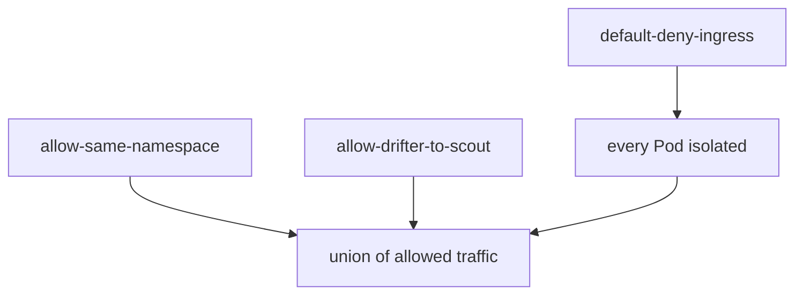

# Default Deny And Namespace Isolation

A namespace becomes a security boundary only when you build it from policies. The usual way is to isolate every Pod first and then to open the connections that the applications need. This part shows the isolating policies, the allow policies that go with them and how the allowed traffic of several policies is combined.

## Learning objectives

- Write default-deny policies for ingress, egress and both.
- Allow traffic inside a namespace and from one named namespace.
- Use `ipBlock` with `except` and port ranges.
- Predict the union of several policies.

## Before you start

A policy isolates the Pods it selects for the listed directions, and only rules add allowed traffic. An empty `podSelector: {}` selects every Pod in the namespace.

<!-- astrona:playground:renew -->

Confirm the starting point. No policy blocks anything in `starfleet`, and `drifter` in `outpost` reaches `bridge`:

```sh
kubectl -n outpost exec deploy/drifter -- curl -s --max-time 3 -o /dev/null -w '%{http_code}\n' http://bridge.starfleet/
```

## Default deny

Save this as `default-deny-ingress.yaml`. It selects every Pod in `starfleet`, lists `Ingress` and has no `ingress` rules, so it allows nothing:

```yaml
apiVersion: networking.k8s.io/v1
kind: NetworkPolicy
metadata:
  name: default-deny-ingress
  namespace: starfleet
spec:
  podSelector: {}
  policyTypes:
    - Ingress
```

Apply it and repeat the request from `drifter` and a request from `shuttle` to `bridge`:

```sh
kubectl apply -f default-deny-ingress.yaml
```

Both requests now time out. The policy isolated every Pod for ingress, including `bridge`, and nothing allows a client in. The same shape with `Egress` as the type denies all egress, and a policy that lists both types and no rules denies both directions.

A default-deny policy is the base of every other policy in the namespace. Without it, a Pod that no policy selects accepts everything, so a new Deployment in the namespace would start unprotected. With it, a new Pod is isolated from its first second.

## Allow traffic inside the namespace

Isolating a whole namespace usually leaves its own Pods unable to talk to each other. Save this as `allow-same-namespace.yaml`:

```yaml
apiVersion: networking.k8s.io/v1
kind: NetworkPolicy
metadata:
  name: allow-same-namespace
  namespace: starfleet
spec:
  podSelector: {}
  policyTypes:
    - Ingress
  ingress:
    - from:
        - podSelector: {}
```

The `from` entry selects every Pod in the policy namespace and nothing else. Apply it and send the two requests again:

```sh
kubectl apply -f allow-same-namespace.yaml
```

The request from `shuttle` returns 200 and the request from `drifter` still times out. The two policies are now both active on every Pod, and their allowed traffic is added: the default-deny policy contributes nothing, and the second policy contributes the namespace.

## Allow one peer from another namespace

To admit one client from `outpost`, select it by namespace and Pod label in a single entry. Save this as `allow-drifter-to-scout.yaml`:

```yaml
apiVersion: networking.k8s.io/v1
kind: NetworkPolicy
metadata:
  name: allow-drifter-to-scout
  namespace: starfleet
spec:
  podSelector:
    matchLabels:
      app: scout
  policyTypes:
    - Ingress
  ingress:
    - from:
        - namespaceSelector:
            matchLabels:
              kubernetes.io/metadata.name: outpost
          podSelector:
            matchLabels:
              app: drifter
      ports:
        - protocol: TCP
          port: 9898
```

Apply it and request `http://scout/` from `drifter` using the Service name `scout.starfleet`. The request succeeds, while a request from `drifter` to `bridge` still times out. Because the namespace and the Pod selector are in one entry, a different Pod in `outpost` would not be allowed.



Isolation comes from selection, and the allowed traffic is the union of all rules of all policies that select the Pod.

## Address ranges and port ranges

Two more fields appear in real policies. `ipBlock` allows a range from outside the cluster and may exclude parts of it:

```yaml
- from:
    - ipBlock:
        cidr: 10.20.0.0/16
        except:
          - 10.20.5.0/24
```

The `except` ranges must lie inside the `cidr`. Use `ipBlock` for fixed addresses such as an office network or an external monitoring system, because Pod addresses change. The behaviour of `ipBlock` with traffic that passes a load balancer or a node address depends on the plugin, since the source address may have been rewritten before the policy is evaluated.

Ports can be given as a range with `port` and `endPort`. This allows TCP ports 8000 to 8100:

```yaml
ports:
  - protocol: TCP
    port: 8000
    endPort: 8100
```

`endPort` must be equal to or greater than `port`, and it works only with numeric ports.

## Removing the demo policies

Delete the three policies when you finish, because later experiments need an open namespace:

```sh
kubectl -n starfleet delete networkpolicy default-deny-ingress allow-same-namespace allow-drifter-to-scout
```

## Reading the result

You built the usual structure for an isolated namespace: a default-deny policy, a policy that opens the namespace to itself and one narrow policy for a named peer. The union rule means you can add allow policies in separate files without editing the others: for a Pod that is already isolated, a new policy can only open more traffic. If the namespace is not isolated, check first whether a default-deny policy exists for each direction.

## Common pitfalls

> [!WARNING]
> A default-deny egress policy also blocks DNS. Add a DNS rule before applying it to a live namespace. Do not rely on `ipBlock` for Pod-to-Pod traffic. An empty `from` list or an empty `ingress` list is not the same: an `ingress` entry with no `from` allows every source, while no `ingress` entry allows none.
