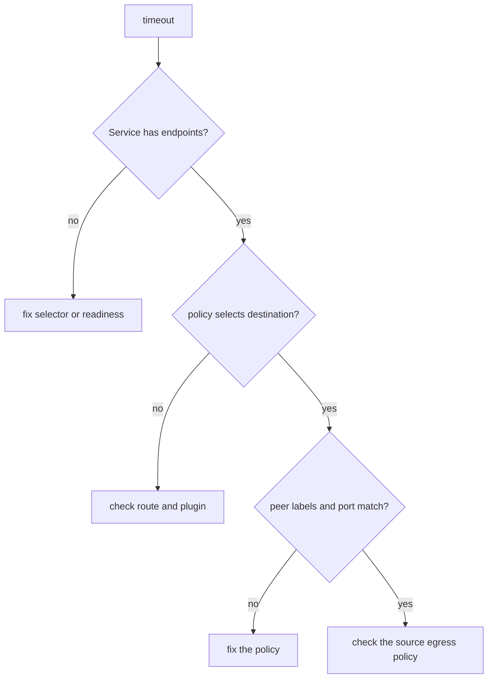

# Verifying And Troubleshooting Policies

When a policy does not do what its author meant, the symptom is always one of two: a connection that should work times out, or a connection that should be dropped succeeds. This part gives a fixed order of checks and shows the five mistakes that cause nearly every case.

## Learning objectives

- Follow a fixed order of checks to find the policy that decides a connection.
- Compare policy selectors with real Pod and namespace labels.
- Explain why a policy port is the Pod port and not the Service port.
- Verify that the network plugin enforces policies.

## Before you start

A policy has a protected side (`spec.podSelector`) and peers (`from` or `to`). The decision for one connection uses the policies that select the destination for ingress and the policies that select the source for egress. The playground contains a policy named `probe-ingress` that is wrong on purpose.

<!-- astrona:playground:renew -->

Start with the symptom. The `shuttle` client should reach the `probe` Service, but the request does not return:

```sh
kubectl -n starfleet exec deploy/shuttle -- curl -s --max-time 3 -o /dev/null -w '%{http_code}\n' http://probe/
echo "exit code: $?"
```

The request ends with a timeout, exit code 28. A timeout with a healthy Service points to a drop by a policy, a route problem or a Service without endpoints, and you remove the other two causes first.

## Order of checks

First confirm the Service has ready endpoints, so you do not blame a policy for an empty Service:

```sh
kubectl -n starfleet get endpointslices -l kubernetes.io/service-name=probe
```

The slice has an address, so the Service has a backend. Next list the policies in the namespace of the destination and read the one that selects it:

```sh
kubectl -n starfleet get networkpolicy
kubectl -n starfleet describe networkpolicy probe-ingress
```

The description shows the protected Pods, the allowed sources and the allowed ports. Write down the label values and the port. Then compare each value with the real objects.

## Compare labels and ports

Read the labels of the client, the destination and the namespaces:

```sh
kubectl -n starfleet get pods --show-labels
kubectl get namespaces --show-labels
```

The policy allows `app: shutle` while the client is labelled `app: shuttle`. A selector with a label that no Pod has selects nothing, and the policy then allows nobody. The error is silent because the API accepts any label value. Next compare the port. The policy lists port 8081, but the `probe` Pod listens on 8080. Read the container port:

```sh
kubectl -n starfleet get deployment probe -o jsonpath='{.spec.template.spec.containers[0].ports[*].containerPort}{"\n"}'
```

A policy matches the destination port of the packet after the Service address has been replaced by the Pod address. The Service listens on port 80 and forwards to Pod port 8080, so the rule must allow 8080. A rule for port 80 would not match.

## Fix and verify

Edit the policy so that the label is `shuttle` and the port is 8080, then apply it. Test both directions: the client that should work, and a client that must stay blocked:

```sh
kubectl -n starfleet edit networkpolicy probe-ingress
kubectl -n starfleet exec deploy/shuttle -- curl -s --max-time 3 -o /dev/null -w '%{http_code}\n' http://probe/
kubectl -n outpost exec deploy/drifter -- curl -s --max-time 3 -o /dev/null -w '%{http_code}\n' http://probe.starfleet/
```

The first request returns 200 and the second times out. A fix is complete only when both results are right, because widening a policy until the working client passes is a common way to break the isolation.



Work from the Service to the policy to the peer and port, and look at the source egress policy last.

## Other causes to rule out

The namespace of the policy matters: a policy applies only to Pods in its own namespace, so a policy created in the wrong namespace protects nothing. A `namespaceSelector` uses namespace labels, not names, and only the label `kubernetes.io/metadata.name` is guaranteed to exist. A Pod that uses the host network shares the address of the node, and plugins treat such Pods and node traffic in different ways, so do not rely on a policy for them without reading the plugin documentation.

If every test succeeds although a policy should drop traffic, check that the plugin enforces policies. A policy object is accepted by any cluster, and a plugin without support ignores it. Calico is installed in the playground, so it enforces policies there. If a policy that should drop a request does not, and the plugin does enforce policies, the policy does not select the destination Pod: compare its `podSelector` with the Pod labels.

## Reading the result

You followed the order a Service, a policy, labels, port and source egress, and found two silent mistakes: a label that matches nothing and a port taken from the Service instead of the Pod. Each check removes one possible layer. When you change a policy, test the connection that must work and the connection that must stay blocked, and change one value at a time.

## Common pitfalls

> [!WARNING]
> Do not delete a policy to see whether it is the cause in a shared cluster: removing a policy changes the traffic of every Pod it selected, and removing the last isolating policy of a Pod opens all traffic to it. Read it first with `describe` and test with a copy in a test namespace. A policy for the Service port instead of the Pod port allows nothing, and a typo in a label does not produce an error.
