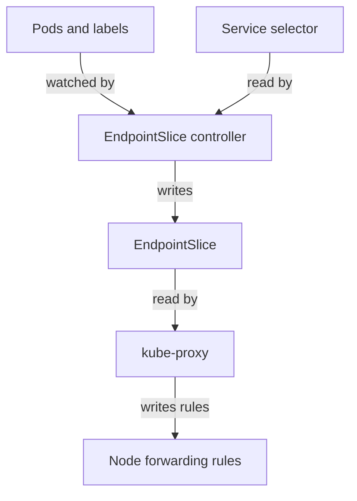

# Selectors, Ports And Backends

Pods are replaced all the time, and every new Pod gets a new IP address. A client cannot follow that. A Service solves this by giving the clients one address that does not change and by keeping a list of the Pods behind it. This part shows how that list is built from a selector, how a port is mapped to a container, and where each step stores its result.

A Service of the default type `ClusterIP` gets a virtual IP address from the cluster's Service range. The address belongs to no network interface. It exists only as a forwarding rule that `kube-proxy`, a component that runs on every node, writes into the node's packet filter. When a Pod sends a packet to the ClusterIP, the rule on its own node rewrites the destination to the IP address and port of one backend Pod.

## From selector to EndpointSlice

The field `spec.selector` of a Service is a set of label key and value pairs. A Pod is a backend when its labels contain every pair. The EndpointSlice controller, which runs inside `kube-controller-manager`, watches Pods and Services. For each Service with a selector it creates EndpointSlice objects that hold the address, the port and the conditions of each matching Pod. It labels every slice with `kubernetes.io/service-name`, so you can find the slices of one Service.

In the playground, the `probe` Pods carry the labels `app: probe` and `release: probe`. Look at the Service selector first, then at the labels of the Pods:

<!-- astrona:playground:renew -->

```sh
kubectl -n starfleet get service probe -o jsonpath='{.spec.selector}{"\n"}'
kubectl -n starfleet get pods --show-labels
```

The selector contains `release: missing`, and no Pod has that label. Ask the API server how many Pods the selector matches, then read the slices of the Service:

```sh
kubectl -n starfleet get pods -l app=probe,release=missing
kubectl -n starfleet get endpointslices -l kubernetes.io/service-name=probe
```

The first command lists no Pods. The second command lists one EndpointSlice with no addresses. The Service exists, it has a ClusterIP and it answers DNS, but it has nothing to forward to. Kubernetes reports no error for this case, because an empty selector match is a valid state. A Pod IP that you request directly still works, which is why a direct request never proves that the Service is correct.



The diagram shows that the Service object itself carries no addresses: the controller builds them, and `kube-proxy` consumes them.

## What the ClusterIP does on the node

The ClusterIP is allocated by the API server when the Service is created and does not change for the life of the Service. Print the type, the address and the ports with one command:

```sh
kubectl -n starfleet get service probe -o wide
```

The columns `TYPE`, `CLUSTER-IP`, `EXTERNAL-IP`, `PORT(S)` and `SELECTOR` show the type, the virtual address, the external address (empty for ClusterIP) and the selector. `kube-proxy` watches the Service and its EndpointSlices through the API server. For each Service port it writes rules on its node that match packets sent to the ClusterIP and the Service port, and for each ready address it adds one possible destination. The rule chooses one destination for each new connection. The choice is made again for every new connection, and a connection that is already open keeps its destination.

Because every node has the same rules, the ClusterIP works from every Pod on every node. It does not work from outside the cluster, because a machine that is not a cluster node has no such rule and the address is not routed anywhere. This limit is the reason the other Service types exist.

## Port and targetPort

A Service port entry has up to three numbers. The `port` is the port on the ClusterIP that clients use. The `targetPort` is the port on the backend Pod that receives the connection. When `targetPort` is not set, it defaults to the value of `port`. For a NodePort or LoadBalancer Service there is a third number, the `nodePort`, which the next part covers.

The `targetPort` can be a number or the name of a container port. In the playground, the Deployment declares `containerPort: 8080` with `name: http`, and the Service uses `targetPort: http`. The EndpointSlice controller resolves the name for each Pod and stores the number in the slice. A name has one advantage: two Deployment versions can use different numbers behind the same name, and the Service keeps working.

The port declaration in a Pod is documentation for people and for name resolution. It does not open a socket. The Python process in the container must itself listen on 8080 on an address that is not only the loopback address. If the `targetPort` points at a port where nothing listens, the node answers the connection with a refusal, and the client sees `Connection refused` and not a timeout.

## Readiness and the ready condition

Each address in an EndpointSlice has conditions. The condition `ready` is true when the Pod has the Pod condition `Ready`, and that condition follows the readiness probe of the containers. The `probe` Pods have a readiness probe on `/ready` of the same server. When the probe fails, the kubelet marks the Pod not ready, the controller sets `ready: false` on its address, and `kube-proxy` removes the address from the rules for new connections.

A Pod can show the status `Running` and still receive no Service traffic. The column `READY` of `kubectl get pods` shows this as `0/1`. Print the conditions of the slices for the `probe` Service after the selector is fixed to see both addresses with `ready: true`:

```sh
kubectl -n starfleet get endpointslices -l kubernetes.io/service-name=probe -o yaml
```

In the YAML, the field `endpoints` lists one entry per Pod with `addresses`, `conditions.ready` and `targetRef`, and the field `ports` lists the resolved port number. The `serving` and `terminating` conditions exist for rolling updates: a terminating Pod keeps serving existing requests, but new traffic goes to other Pods. With the selector still wrong, `endpoints` is empty, so the check you just made is the evidence for the fault.

## Services without a selector

A Service can have no `spec.selector`. Then the EndpointSlice controller creates nothing, and an administrator or another controller writes the EndpointSlice by hand, with the label `kubernetes.io/service-name` set to the Service name. This is used to give a stable name to an address outside the cluster, for example a database on a virtual machine. The older Endpoints object is deprecated in favour of EndpointSlices, but `kubectl get endpoints` still works and shows a similar list.

A selector-based Service with a wrong label and a selectorless Service without a slice look the same to a client: the Service exists and no backend answers. Read the Service YAML first to know which of the two cases you have.

The same chain explains why a Service keeps working while Pods change. When a Deployment replaces a Pod, the controller removes the old address from the slice and adds the new one. `kube-proxy` then updates the rules on each node. The ClusterIP, the Service port and the DNS name stay the same during this change. A connection that was open to the old Pod still ends when that Pod stops, so clients must be able to retry.

You now know the three links of the chain: the selector chooses the Pods, the EndpointSlice records them with their readiness, and the port mapping tells `kube-proxy` where on the Pod to connect. What is still open is how a client outside the cluster enters this chain.

## Common pitfalls

> [!WARNING]
> A Service does not start an application listener, and a `containerPort` entry does not open a port. Pod names that look alike do not select anything: only labels and readiness do. When the selector has two labels, a Pod needs both. Do not test a Service by requesting a Pod IP, because that skips the selector, the EndpointSlice and the `kube-proxy` rules.
