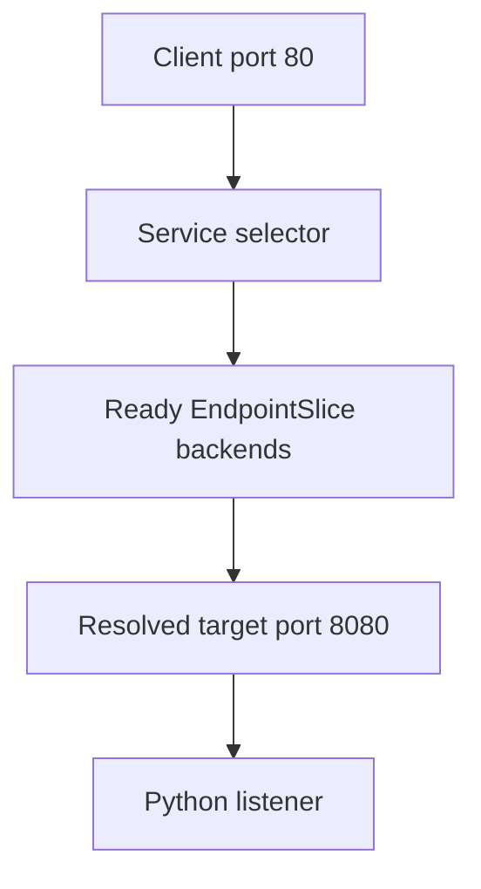

# Selectors, Ports And Backends

The `probe` Service exposes port 80 while its selected application listens on port 8080. These ports describe two sides of forwarding. Correct labels cannot compensate for a target port that points to the wrong listener.

## Learning objectives

- Compare ClusterIP, NodePort and LoadBalancer responsibilities.
- Trace Service and target port mapping.
- Explain selected ready endpoints.

## Before you start

This chapter is standalone reading material; no running cluster or installed tools are required. A Pod is the Kubernetes unit for running one or more containers, and a namespace groups namespaced objects. Treat the worked configurations as teaching examples rather than recorded observations from a provisioned environment.

## Responsible components and behavior

The `probe` application has three Pods, and clients need one stable destination. A Service defines an access point and, for a selector-based Service, identifies backends by Pod labels. EndpointSlices store sets of network endpoints and related information, including readiness conditions used by forwarding implementations.

A Service's `port` is the port exposed to clients. Its `targetPort` identifies the destination port on the backend. The application must actually listen at that destination. Changing the Service port does not reconfigure the application's listener.

A selector mismatch can leave a Service with no matching endpoints even while all intended Pods are Running. A readiness failure can also make a backend unavailable for ordinary traffic. Inspect selection and readiness separately. Kubernetes does not infer that a Pod belongs behind a Service merely because their names look similar.

A ClusterIP Service provides a virtual address for access within the cluster's network reachability boundaries. It is not automatically an externally reachable public endpoint. The address and forwarding implementation remain stable while backends change, though existing connections can still be affected by failures.

A Service can also exist without a selector when endpoints are managed through another mechanism. Such a Service is not proof that the normal Pod selector controller created its backend records. Read the configuration before assuming one discovery method applies to every Service.

Imagine a Service exposes port 80 but forwards to port 8080, while the application listens on 9000. Correct labels alone cannot fix that mismatch. Diagnose the access point, endpoint set and listener as three parts of the same request path.

## Evaluating A Complete Backend Relationship

Suppose `probe` Pods carry `app: probe` and listen on port 8080. A Service selecting `app: probe` exposes port 80 and forwards to 8080. Clients address port 80; the application receives traffic at 8080. These two numbers describe different sides of the forwarding relationship.

If the selector changes to `app: scout`, healthy `probe` Pods no longer satisfy it. If the selector remains correct but the target changes to 9000, the discovered endpoint can be valid while connections fail at the destination listener. If labels and ports are correct but readiness fails, ordinary traffic eligibility can still be reduced. Diagnose each relationship separately.

A named target port can connect the Service to a port name in selected Pods. This can improve readability and support consistent contracts even when concrete port numbers vary appropriately. The name still needs to resolve to a meaningful container port declaration, and that declaration does not itself start the application listener.

## EndpointSlices And Readiness

EndpointSlices divide backend information into manageable records rather than relying on one arbitrary list of Pod names. They can include addresses, ports and conditions used by consumers of that endpoint information. Readiness is important to ordinary Service routing, while specialized settings can change publication behavior for applications that need to discover not-yet-ready members.

That distinction matters for databases or peer discovery. Publishing an endpoint is not the same as telling ordinary callers it can safely serve requests. An author should state which discovery and traffic behavior the application needs rather than assume every Service treats all endpoints identically.

The stable Service abstraction helps absorb Pod replacement, but existing connections and application errors remain outside a promise of uninterrupted success. A complete explanation traces client port, selection, endpoint eligibility and destination listener. A healthy observation at one step cannot replace evidence at the next.

## Work through the decision

The Service selector requires both `app: probe` and `release: probe`. The EndpointSlice controller uses matching Pods and their readiness to build backend information. Its stored ports reflect target-port resolution, including named port references. The network implementation consumes those backends when routing Service connections.

The named target `http` refers to the selected Pod's declared port 8080. That declaration does not open a socket. The Python process must actually listen at the expected address and port. If selection is empty, investigate labels; if selected Pods are unready, investigate health; if ready endpoints use the wrong destination port, investigate mapping and listener. These are distinct defects.

Selection identifies the backend population, while port mapping identifies where that population must listen.

You can now explain the complete Service backend relationship. Its declared correctness is useful evidence, but actual application reachability and meaningful responses need caller-side verification.

## Common pitfalls

> [!WARNING]
> A Service does not start an application listener. Matching names do not select Pods; labels, readiness and port mapping determine the backend path.
