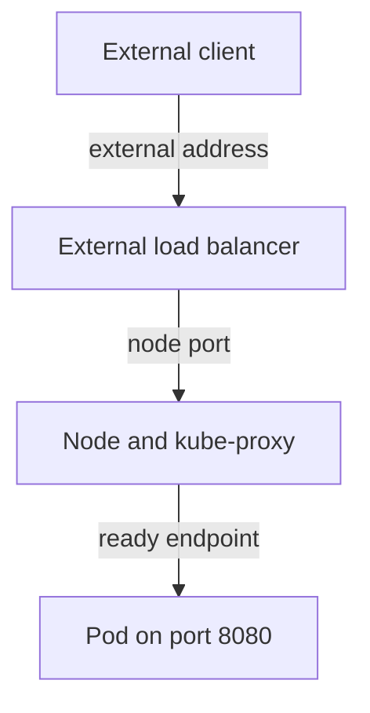

# External Entry And Application Routing

A ClusterIP Service works only inside the cluster. A team that wants browsers or other systems outside the cluster to reach `probe` must choose another entry. This part explains what each Service type adds, which component does the work, and what each type needs from the infrastructure around the cluster.

The three Service types build on each other. A `NodePort` Service is also a ClusterIP Service. A `LoadBalancer` Service is also a NodePort Service by default. Each type keeps the behaviour of the one before it and adds one more way in.

## NodePort

A NodePort Service opens the same port number on every node of the cluster. The API server picks the number from the NodePort range, which is 30000 to 32767 by default and is set by the flag `--service-node-port-range` of the API server. You can also choose a number inside that range yourself with `nodePort`. Two Services cannot use the same number.

The component that opens the port is `kube-proxy`, not the Service object. On each node it writes rules that match packets sent to any address of that node on the node port, and it forwards them to the ready backends in the EndpointSlice, in the same way as for the ClusterIP. The backends can be on other nodes, so a request to one node can end at a Pod on another node.

<!-- astrona:playground:renew -->

Save this as `service-probe-nodeport.yaml`:

```yaml
apiVersion: v1
kind: Service
metadata:
  name: probe
  namespace: starfleet
spec:
  type: NodePort
  selector:
    app: probe
    release: probe
  ports:
  - name: http
    port: 80
    targetPort: http
    nodePort: 30080
```

Apply it:

```sh
kubectl apply -f service-probe-nodeport.yaml
```

The file also fixes the selector, so the Service now has two backends. Then check the type and the node addresses, and request the node port from the `shuttle` client Pod. Replace `<NODE_IP>` with an `INTERNAL-IP` from the node list:

```sh
kubectl -n starfleet get service probe
kubectl get nodes -o wide
kubectl -n starfleet exec shuttle -- wget -q -T 3 -O- http://<NODE_IP>:30080/
```

The Service column `PORT(S)` shows `80:30080/TCP`, which reads as the Service port, a colon and the node port. The answer of the request starts with `version=v1` and names the Pod host. In the kind playground the node addresses are private container addresses, so only Pods and the container engine host can reach them.

## What NodePort needs from the network

The Kubernetes object does not make a node reachable. A client outside the cluster needs a route to the node address, and every firewall and security group on the way must allow the node port. On a cloud provider the nodes often have only private addresses, so a NodePort alone is not reachable from the internet.

A NodePort also exposes the Service on every node, including nodes that run no backend Pod. The field `externalTrafficPolicy` decides what such a node does. With the default `Cluster`, the node forwards the connection to any ready backend in the cluster and replaces the client source address with its own address, so the Pod does not see the real client address. With `Local`, the node forwards only to backends on the same node, keeps the client source address, and drops the connection when no local backend exists.

## LoadBalancer

A Service of type `LoadBalancer` asks the environment for an external load balancer. The Service controller inside `cloud-controller-manager` watches such Services. On a cloud provider it creates the load balancer through the provider API, points it at the node port of every node, and writes the address into `status.loadBalancer.ingress`. The column `EXTERNAL-IP` then shows that address.

Without such a controller, nothing watches the Service type. The Service still gets its ClusterIP and its node port, but `EXTERNAL-IP` stays at `<pending>`. A kind cluster, a bare-metal cluster and most laboratory clusters are in this state until a component such as MetalLB or `cloud-provider-kind` is installed. A pending address therefore says that no controller provides the load balancer. It does not say that the application failed.

When a LoadBalancer works, a request takes this path:



The diagram shows that the load balancer reaches the Pod through the same node port and `kube-proxy` rules as a NodePort Service.

## Routing for web traffic

Services work on the transport level: they forward TCP or UDP connections by address and port. They cannot choose a backend by host name or URL path. For that, a cluster runs a controller that implements an Ingress or a Gateway API route. The controller itself is usually exposed with one LoadBalancer or NodePort Service, and it forwards each HTTP request to a normal ClusterIP Service by the rules in the route.

An Ingress or HTTPRoute object does nothing without that controller. The Service behind the route still needs selected, ready backends. This means that external web access depends on four things that can fail alone: a reachable entry address, a running controller, a matching route and a Service with ready endpoints.

You can now tell what each type adds: a ClusterIP gives an internal address, a NodePort adds a port on every node, and a LoadBalancer asks for an external address on top of the node port. The open question is how to find out which of these links is broken when a request fails.

## Common pitfalls

> [!WARNING]
> Do not expect `EXTERNAL-IP` to be filled in on a cluster without a load balancer controller. A node port outside 30000 to 32767 is rejected unless the API server range was changed. A reachable node IP inside a private network does not mean the port is reachable from the internet, because a firewall can still block it. With `externalTrafficPolicy: Local`, a node with no local backend drops the connection.
