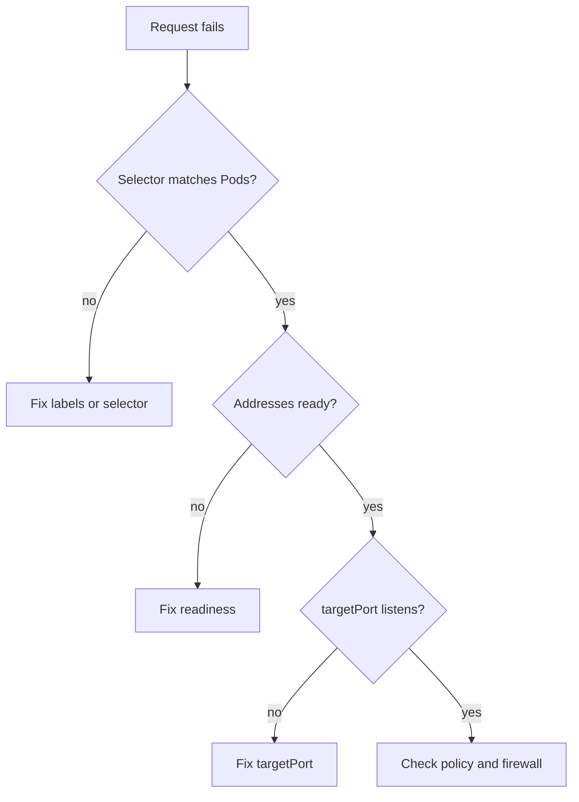

# Diagnosing A Service With No Working Backend

When a request to a Service fails, the client message is short and many causes look alike. A fixed order of checks turns the failure into one named cause. This part gives that order and then causes two of the faults on purpose, so you can see what each one looks like before you meet it under pressure.

The order follows the path of a request. First check that the selector matches Pods, then that the EndpointSlice holds ready addresses, then that the `targetPort` matches a listener, and last that nothing outside the Service blocks the connection. Each check reads one object, so each takes one command.

## The four checks

The first check compares the selector with the Pod labels. `kubectl get pods -l <selector>` with the selector of the Service shows which Pods match. An empty list means the selector is wrong, and no other check is needed yet.

The second check reads the EndpointSlices of the Service. An empty `endpoints` list means that no Pod matches or that no Pod exists. An address with `ready: false` means the Pod is selected but its readiness probe fails. The third check compares the `targetPort` in the Service with the port the process really listens on. The fourth check looks for causes outside the Service, such as a NetworkPolicy or a firewall. Those causes give a timeout, while a wrong `targetPort` gives a refusal.

The order matters because each check removes whole classes of causes. If the selector matches Pods, labels are no longer a suspect. If the slice has ready addresses, the Pod health is no longer a suspect. Checking in the wrong order often leads to changes that hide the real fault, for example changing the Service port when the selector was wrong.

The commands below assume the `probe` Service has the selector `app: probe` and `release: probe`. The playground starts with a wrong selector, so set `spec.selector` to `app: probe` and `release: probe` first, for example with `kubectl patch service probe --type merge -p '{"spec":{"selector":{"release":"probe"}}}'`. Then check the starting state:

<!-- astrona:playground:renew -->

```sh
kubectl -n starfleet get endpointslices -l kubernetes.io/service-name=probe
kubectl -n starfleet exec shuttle -- wget -q -T 3 -O- http://probe/
```

The slice lists two addresses, and the request answers with `version=v1`. This is the healthy baseline to compare with.

## A wrong targetPort

You now break the port mapping. Change the `targetPort` to 9000, where no process listens:

```sh
kubectl -n starfleet patch service probe --type merge -p '{"spec":{"ports":[{"name":"http","port":80,"targetPort":9000}]}}'
kubectl -n starfleet exec shuttle -- wget -q -T 3 -O- http://probe/
```

The request fails at once, and `wget` reports that it cannot connect. The node that holds the Pod answers the connection to port 9000 with a reset, because no socket is open there. The slices still list the Pods as ready, because readiness checks port 8080, not the Service `targetPort`. The conclusion is that a quick failure with ready endpoints points at the port mapping.

Run the slice command again, and read the `ports` field. It now shows 9000 instead of 8080. This is the evidence for the fault: the Service sends traffic to a port that the container never opened. Set the `targetPort` back with the name that the Pods declare:

```sh
kubectl -n starfleet patch service probe --type merge -p '{"spec":{"ports":[{"name":"http","port":80,"targetPort":"http"}]}}'
```

## A Pod that is not ready

The server of `probe` answers the path `/ready` with status 503 while the file `/tmp/not-ready` exists in its container. Create the file in one Pod, wait a few seconds, and read the Pods and the slices:

```sh
kubectl -n starfleet exec deploy/probe -- touch /tmp/not-ready
kubectl -n starfleet get pods -l app=probe
kubectl -n starfleet get endpointslices -l kubernetes.io/service-name=probe -o yaml
```

One Pod shows `0/1` in the `READY` column while its status stays `Running`. The slice marks its address with `ready: false`. The kubelet runs the probe every 2 seconds and needs three failures in a row by default, so allow about 6 seconds. New requests to the Service now go only to the other Pod, and they still succeed. Remove the file, and the Pod returns to the ready addresses after the next successful probe:

```sh
kubectl -n starfleet exec deploy/probe -- rm /tmp/not-ready
```

The `deploy/probe` form of `kubectl exec` picks one Pod of the Deployment. If the file was created in one Pod and the removal reaches the other one, the first Pod stays not ready. List the Pods with `kubectl get pods` and use the Pod name for both commands when you want to be exact.



The diagram turns the four checks into a decision order, and each answer names the object to change.

## Reading the symptom

The symptoms below are only a starting point, because a client message can have more than one cause. Always confirm the cause in the object before you change anything.

Each fault leaves a different trace at the client and in the objects. An empty selector match gives an empty slice and a failing request. A failed readiness probe gives `ready: false` and a normal answer from the remaining Pods, or no answer when no Pod is ready. A wrong `targetPort` gives a quick refusal with ready addresses. A policy or firewall gives a timeout with ready addresses and a correct port.

You can now find the cause of a Service without a working backend in a fixed order, and you have seen two of the four causes appear and disappear. The next step is to practise the repair of a selector without help.

## Common pitfalls

> [!WARNING]
> Do not change the Service port to match a wrong client; clients keep using the documented port. Do not delete and recreate a Service to repair a selector, because the ClusterIP changes. A `Running` Pod is not the same as a ready Pod. When you test a fix, request the Service name, not a Pod IP.
