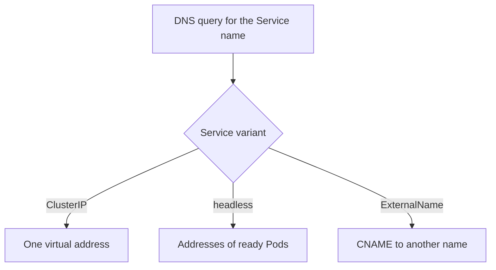

# Headless, ExternalName And Selectorless Services

A normal Service hides its Pods behind one virtual address, and `kube-proxy` picks the backend for each connection. That is the right design for a stateless web application. It is the wrong design when the client must know every Pod, for example a database client that connects to each replica, or when the target is not a Pod at all. This part shows three Service variants for these cases and what each one changes in the cluster DNS answer.

The cluster DNS server (CoreDNS) answers every query for a Service name from the Service and EndpointSlice objects. The variant of the Service decides what the answer holds. You will see the difference with the playground, because the `shuttle` Pod has `nslookup`.

## The baseline answer for a ClusterIP Service

First look up the normal Service `probe` from `shuttle`. The full name of a Service is `<service>.<namespace>.svc.cluster.local`.

<!-- astrona:playground:renew -->

```sh
kubectl -n starfleet exec deploy/shuttle -- nslookup probe.starfleet.svc.cluster.local
kubectl -n starfleet get service probe
```

The answer holds one address, and it equals the `CLUSTER-IP` column. The client has no way to learn which Pods stand behind it. `kube-proxy` makes that choice on the node, for each new connection.

## Headless Services

A Service is headless when `spec.clusterIP` is set to `None`. The API server then allocates no virtual address, and `kube-proxy` writes no forwarding rules for it. With a selector, the EndpointSlice controller still creates the slices. CoreDNS reads them and answers the Service name with one A record for each ready Pod address.

Save this as `service-probe-pods.yaml`:

```yaml
apiVersion: v1
kind: Service
metadata:
  name: probe-pods
  namespace: starfleet
spec:
  clusterIP: None
  selector:
    app: probe
  ports:
  - name: http
    port: 80
    targetPort: http
```

Apply it:

```sh
kubectl apply -f service-probe-pods.yaml
```

Then compare the DNS answer with the Pod addresses:

```sh
kubectl -n starfleet exec deploy/shuttle -- nslookup probe-pods.starfleet.svc.cluster.local
kubectl -n starfleet get pods -l app=probe -o wide
```

The lookup now returns three addresses, and they equal the `IP` column of the Pods. The client receives all of them and chooses one itself, so the load is spread only as far as the client library rotates through the list. A Pod that is not ready is left out of the answer, unless the Service sets `publishNotReadyAddresses: true`. That field exists for applications that must find their peers before those peers become ready.

Headless Services are the base for StatefulSets. The field `serviceName` of a StatefulSet names a headless Service, and CoreDNS then gives each Pod its own name in the form `<pod>.<service>.<namespace>.svc.cluster.local`. The ports of a headless Service are not translated, because no `kube-proxy` rule sits between the client and the Pod: a client connects to the Pod port directly.

## ExternalName Services

An ExternalName Service maps a name inside the cluster to another DNS name. It has no selector, no ClusterIP and no EndpointSlice. CoreDNS answers a query for the Service name with a CNAME record that holds the value of `spec.externalName`, and the client then resolves that target name.

Save this as `service-ledger-externalname.yaml`:

```yaml
apiVersion: v1
kind: Service
metadata:
  name: ledger
  namespace: starfleet
spec:
  type: ExternalName
  externalName: ledger.outpost.svc.cluster.local
```

Apply it:

```sh
kubectl apply -f service-ledger-externalname.yaml
```

Then look up the name and request it:

```sh
kubectl -n starfleet exec deploy/shuttle -- nslookup ledger.starfleet.svc.cluster.local
kubectl -n starfleet exec deploy/shuttle -- wget -q -T 3 -O- http://ledger/
```

The lookup follows the CNAME to the ClusterIP of the `ledger` Service in `outpost`, and the request answers from the `outpost` Pod. The name `ledger` in `starfleet` is only an alias. Nothing proxies the connection, so the target must accept the connection as it arrives. A port is not translated, and an HTTP server that checks the `Host` header sees `ledger`, not the target name. Applications that use TLS can fail because the certificate does not contain the alias. The value must be a DNS name, not an IP address.

## Services without a selector

A Service with no `selector` gets no EndpointSlice from the controller, so it has a ClusterIP and no backends. You supply the backends with your own EndpointSlice. This gives a stable in-cluster name to an address that lives outside the Pod network, for example a database on a virtual machine.

The EndpointSlice must carry the label `kubernetes.io/service-name` with the name of the Service. Its `addressType` is `IPv4`, and each endpoint lists its addresses. The port in the slice is the port on the target, and the Service `targetPort` is matched against it by name or number. The controller does not check that the address exists or answers, so a wrong address gives a timeout and no error in the Service.



The diagram shows that the Service variant decides the DNS answer, and the answer decides who chooses the backend.

You now know three ways to change what a Service name resolves to. A headless Service returns the Pods, an ExternalName Service returns another name, and a selectorless Service returns what you put in its slice. The open question is how to control which of several backends a client reaches, and from where.

## Common pitfalls

> [!WARNING]
> A headless Service has no ClusterIP, so a client that uses a fixed `clusterIP` value cannot use it. An ExternalName Service does not forward anything and does not translate ports; its `externalName` cannot be an IP address. A selectorless Service without an EndpointSlice has no backends and the Service gives no error. Do not use a headless Service when you want `kube-proxy` to balance the load.
