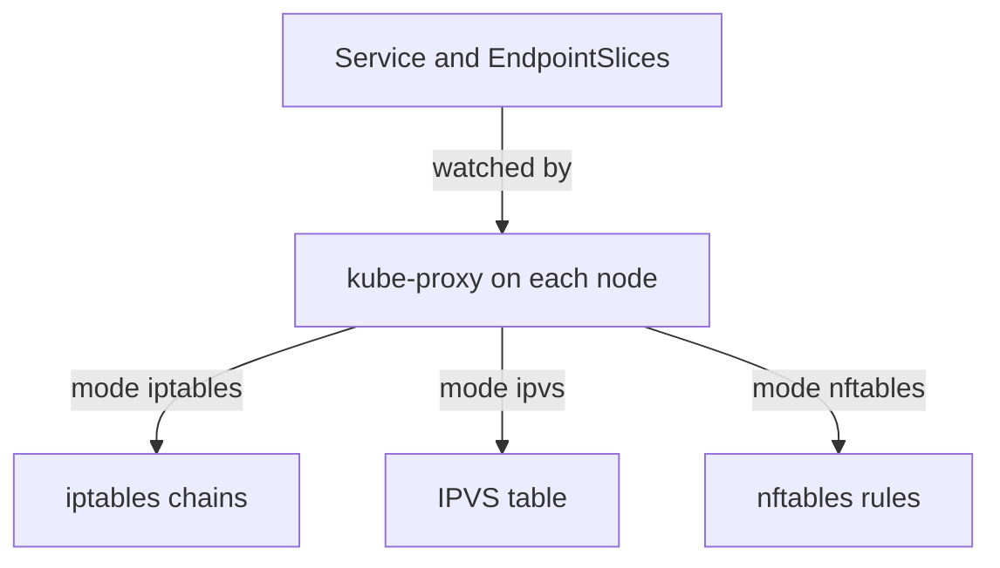

# Session Affinity, Traffic Policy And kube-proxy

By default, `kube-proxy` chooses a backend separately for every new connection, so two requests from one client can reach two Pods. Some applications keep state in the memory of one Pod, and some need the real client address or the shortest network path. This part covers the Service fields that change the choice of backend, and the `kube-proxy` modes that carry out the choice.

## What the default does

The Pod `shuttle` opens a new connection for each `wget` call. Send ten requests to the Service `probe`, and print the Pod name that answers each time. The `podinfo` server returns a JSON document with the field `hostname`.

<!-- astrona:playground:renew -->

```sh
for attempt in 1 2 3 4 5 6 7 8 9 10; do kubectl -n starfleet exec deploy/shuttle -- wget -q -T 3 -O- http://probe/ | grep -o '"hostname": *"[^"]*"'; done
```

The output lists the names of the three Pods in an uneven order. In the `iptables` mode, `kube-proxy` selects a backend with a random choice for each new connection, so the result is random and not a strict rotation. That is the behaviour of the baseline Service.

## Session affinity

Session affinity makes `kube-proxy` send every new connection from one client to the same backend. The field `spec.sessionAffinity` is `None` by default, and `ClientIP` is the only other value. The client is identified by its source IP address. The field `spec.sessionAffinityConfig.clientIP.timeoutSeconds` sets how long the choice is kept after the last connection, and the default is 10800 seconds (three hours).

Patch the existing Service, so the ClusterIP stays the same:

```sh
kubectl -n starfleet patch service probe --type merge -p '{"spec":{"sessionAffinity":"ClientIP","sessionAffinityConfig":{"clientIP":{"timeoutSeconds":600}}}}'
```

Then repeat the ten requests from the previous step. Every answer now names the same Pod. A second client Pod with another IP address can be sent to a different Pod. The affinity is kept in the connection tracking and `kube-proxy` rules on the node, so it is lost when the Pod is removed, and a client behind a network address translation (NAT) device shares one address with all clients behind it. For that reason session affinity is a weak tool for user sessions: store session data in a shared store when the application must keep it.

## How the backend is chosen

It helps to know what `kube-proxy` does when a new connection arrives at a Service address. The kernel looks up the destination in the rules that `kube-proxy` wrote, picks one backend, rewrites the destination address and port to that backend, and records the pair in the connection tracking table. Later packets of the same connection use the recorded pair, so the choice is made once for each connection.

With session affinity on, the rules first check a list of recent clients. If the source address is in the list and its entry has not expired, the kernel uses the same backend again. If the entry is missing, the kernel chooses a backend as usual and adds the client to the list. Each new connection from the client refreshes the timeout.

## externalTrafficPolicy

Traffic that enters through a NodePort or LoadBalancer Service arrives at a node, and that node may have no backend of its own. The field `spec.externalTrafficPolicy` decides what happens. With `Cluster`, the default, the node forwards the connection to any ready backend and rewrites the source address to its own address, so the Pod no longer sees the client address. The extra hop between nodes adds latency, but every node can serve.

With `Local`, the node forwards only to backends on the same node. It keeps the client source address, and it drops the connection when no local backend exists. For a LoadBalancer Service with `Local`, the API server also allocates `healthCheckNodePort`. The external load balancer calls that port on each node, and the node answers with success only if it has a local ready backend. In this way the load balancer sends traffic only to nodes that can serve it.

## internalTrafficPolicy

The field `spec.internalTrafficPolicy` does the same for traffic from Pods inside the cluster. The default `Cluster` sends to any ready backend. The value `Local` sends only to backends on the node of the client Pod, and the connection fails when that node has no ready backend. It reduces cross-node traffic for a service that runs on every node, such as a logging agent.

You can read both policy fields from the Service:

```sh
kubectl -n starfleet get service probe -o jsonpath='{.spec.internalTrafficPolicy}{"\n"}'
```

## Choosing between the fields

The three fields solve different problems, and they do not replace one another. Session affinity answers the question "which backend", and it works per client address. The traffic policies answer the question "where is the backend", and they work per node. An external client that must keep its source address needs `externalTrafficPolicy: Local`. A client that must keep talking to one Pod needs affinity. A node-local agent behind a Service needs `internalTrafficPolicy: Local`.

Each choice has a cost that you can name. Affinity makes the load uneven when one client sends most of the traffic. `Local` makes the load depend on how many Pods run on each node, so an uneven spread of Pods gives an uneven load. Both can hide a backend that is not ready, because a node with no ready local backend drops the connection and does not try another node. Check the EndpointSlices before you blame the network.

## kube-proxy modes

`kube-proxy` runs on every node and turns Services and EndpointSlices into forwarding rules in the kernel. The mode decides which kernel feature holds the rules. In `iptables` mode, the default on Linux, it writes chains such as `KUBE-SERVICES`, one chain for each Service and one rule per backend. In `ipvs` mode it uses the kernel IP Virtual Server load balancer, which holds many Services in a hash table and offers more balancing methods. In `nftables` mode it writes rules in the nftables framework.

The mode is a setting in the `kube-proxy` configuration, which most clusters store in a ConfigMap named `kube-proxy` in the `kube-system` namespace. Read it, and look for the field `mode`:

```sh
kubectl -n kube-system get configmap kube-proxy -o yaml
```

An empty `mode` means the default for the platform. The mode changes the cost and the balancing methods, but it does not change the Service fields that clients and administrators use, and it does not change the result of the DNS lookup. When a Service works on one node and fails on another, a `kube-proxy` Pod that is not running on the failing node is one cause to check.



The diagram shows that every mode reads the same objects and differs only in where it stores the rules.

You now know the fields that change which backend answers: affinity for one client, and the two traffic policies for the location of the backend. The next step is to practise creating these Services without help.

The Service fields stay the same in every mode, which makes them the part to learn first. A problem report says that requests reach the wrong Pod or arrive from the wrong address, and the answer is in the Service fields and the EndpointSlices, not in the kernel rules.

## Common pitfalls

> [!WARNING]
> `sessionAffinity: ClientIP` identifies a client by its source address only, so clients behind one NAT device share one backend. Affinity does not survive the removal of the backend Pod. `externalTrafficPolicy: Local` drops connections on nodes without a local backend, so check where the Pods run before you set it. Do not change the `kube-proxy` mode on a running cluster to repair a Service problem before you have read the Service and its EndpointSlices.
