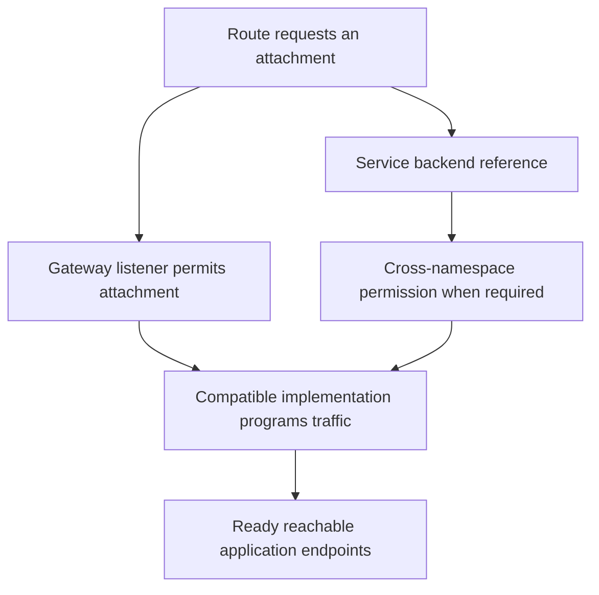

# Gateway API Roles, Listeners And Attached Routes

Gateway API is a collection of Kubernetes resource types for declaring traffic infrastructure and routing relationships. API means application programming interface. Its resources divide responsibilities among infrastructure configuration, a gateway's listeners and application routes. A compatible implementation must install and reconcile the relevant types before declarations provide an active traffic path.

## Separate The Resource Responsibilities

A GatewayClass identifies an implementation and associated configuration contract. A Gateway selects a class and declares listeners. An HTTPRoute describes matching and forwarding for HTTP traffic, where HTTP means Hypertext Transfer Protocol. These resources are connected but are not interchangeable names for one large object.

This separation lets infrastructure operators manage the gateway while application owners manage routes under allowed attachment rules. A route's request to attach is not enough by itself: the selected listener must permit the route's kind and namespace relationship. Both sides contribute to the boundary.

A declaration can be accepted by the Kubernetes API while the implementation is absent or does not support a requested capability. The installed custom definitions provide the schema, while the controller and data plane provide behavior. Discovery and schema validation therefore do not replace controller support and status review.

## Declare The Listener Contract

A listener defines fields such as protocol, port, hostname and permitted route attachments. Transport Layer Security (TLS) settings can identify termination credentials where appropriate. The reachable external address and infrastructure still depend on the selected implementation and its provisioning arrangement.

The listener's hostname and a route's hostnames must have a compatible matching relationship. A route for an unrelated hostname does not become active merely because its parent reference names the Gateway. Naming the intended listener explicitly can distinguish among several listeners on one gateway.

Attachment permission can restrict namespaces and resource kinds. Permitting routes from every namespace expands the set of owners able to influence that entry point. A deliberate administrator review should connect the allowed attachment boundary to actual ownership, rather than use a broad default purely to make one route appear.

## Match And Forward A Request

An HTTPRoute can match request properties such as hostname and path under supported rules. Backend references identify destinations and their ports. For ordinary Service backends, the referenced port is the Service's port contract rather than an arbitrary container listener number.

Weighted backend references can express a forwarding ratio among applicable backends when supported. This differs from approximating exposure by replica counts under an ordinary shared Service. It still requires reachable, healthy backends and an implementation that honors the requested feature. A route's declared weights are not proof of observed business outcomes.

Cross-namespace backend references require appropriate permission through supported reference rules. A ReferenceGrant can authorize specified references into its namespace. Listener attachment permission and permission to reference a backend are separate decisions: allowing a route to attach does not universally let it use every confidential or privileged backend.

## Interpret Status Before Assuming Traffic

Status conditions explain whether a resource or route attachment has been accepted and whether references can be resolved under the contract. A route can have parent-specific status because it can request several attachments. Inspect the status for the intended parent rather than reading an unrelated accepted relationship.

Gateway programming and address observations contribute another layer of evidence. An accepted route can still lack healthy Service endpoints, or an external client can still have incorrect hostname resolution. Follow infrastructure, attachment, references and backend availability separately.

For a `scout` route, identify the class implementation, selected listener, permitted namespace, hostname relationship and Service port. Then examine the relevant attachment and reference conditions and the application's ready capacity. This explains why changing a route match cannot repair an unresolved backend or an absent controller.

## Dependency Flow

## Common pitfalls

> [!WARNING]
> API acceptance does not establish an active Gateway path. Listener attachment, backend-reference permission, implementation support, programming and application health are separate requirements.
