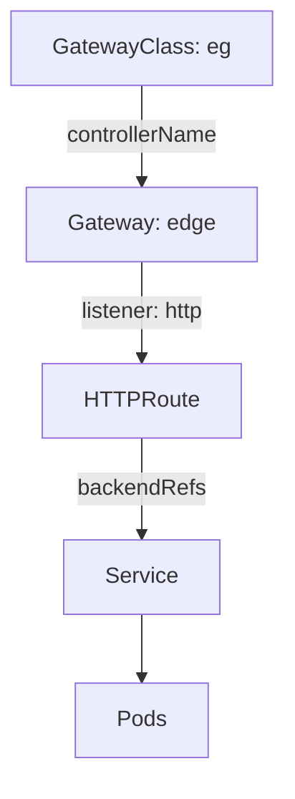

# Gateway API Roles, Listeners And Attached Routes

Before the Gateway API, one Ingress object held everything: the class of controller, the ports, the host names and the backends. A cluster operator and an application team had to edit the same object. The Gateway API divides that object into three kinds so that each owner edits only their part, and so that the controller can report on each part separately. This part explains the three kinds, the component that reads each kind and the fields that connect them.

## The three resource kinds

The Gateway API is a set of custom resource definitions (CRDs). A custom resource definition adds a new resource kind to the Kubernetes API server. The API server stores the objects and checks their fields against the schema, but it does not forward any traffic. A controller, which is a program that watches these objects, does the work. In this playground the controller is Envoy Gateway.

A `GatewayClass` names the controller that handles every Gateway of that class. It is a cluster-scoped object, which means it has no namespace. Its field `spec.controllerName` holds the controller's name, for example `gateway.envoyproxy.io/gatewayclass-controller`. The cluster operator or the platform team owns it.

A `Gateway` is a namespaced object that asks the controller for a traffic entry point. It names a class in `spec.gatewayClassName` and lists one or more listeners. A listener has a `name`, a `protocol`, a `port` and optionally a `hostname` and an `allowedRoutes` rule. When the controller accepts the Gateway, it starts the data plane for it. In Envoy Gateway the data plane is an Envoy proxy Deployment and a Service in the `envoy-gateway-system` namespace.

An `HTTPRoute` is a namespaced object that describes how to match HTTP requests and where to send them. It names its Gateway in `spec.parentRefs` and lists `hostnames`, `rules`, `matches` and `backendRefs`. The application team usually owns it.

<!-- astrona:playground:renew -->

List the installed class and read which controller it names:

```sh
kubectl get gatewayclass
kubectl get gatewayclass eg -o jsonpath='{.spec.controllerName}{"\n"}'
```

The `ACCEPTED` column shows `True` when the controller has recognised the class and is ready to handle Gateways of it. The second command prints the controller name from the class. A Gateway that names a class that does not exist, or a class whose controller is not running, never becomes ready.

## What a listener declares

A listener is one port with one protocol on one Gateway. The protocol `HTTP` accepts plain HTTP. The protocol `HTTPS` terminates Transport Layer Security (TLS) on the listener, which means the proxy decrypts the traffic with a certificate that the listener references. The `hostname` field limits the listener to requests for that host name. A listener without a `hostname` accepts any host name.

The field `allowedRoutes` decides which routes may attach to the listener. Its `namespaces.from` value is `Same` (only routes in the Gateway's own namespace, the default), `All` (routes from every namespace) or `Selector` (routes from namespaces whose labels match). Its `kinds` list limits the route kinds, for example `HTTPRoute` only.

This is a boundary between owners. A team that can create routes in its own namespace cannot publish them on a shared Gateway unless the Gateway owner lets that namespace attach. Choosing `All` removes the boundary, so use it only when every namespace in the cluster is trusted.

The playground starts with this Gateway in the `starfleet` namespace. It has one HTTP listener on port 80 that allows only routes from its own namespace:

```yaml
apiVersion: gateway.networking.k8s.io/v1
kind: Gateway
metadata:
  name: edge
  namespace: starfleet
spec:
  gatewayClassName: eg
  listeners:
    - name: http
      protocol: HTTP
      port: 80
      allowedRoutes:
        namespaces:
          from: Same
```

Read what the controller did with it:

```sh
kubectl -n starfleet get gateway edge
kubectl -n envoy-gateway-system get deploy,svc
```

The `PROGRAMMED` column shows `True` when the controller has configured the data plane. The `ADDRESS` column of `kubectl get gateway` shows the address that clients use. The last command lists the Envoy proxy Deployment and Service that the controller created for this Gateway. The controller created them, not you, and it removes them when you delete the Gateway.

## How a route attaches

A route does not name a port or an address. It names a parent with `parentRefs`, and the controller checks four conditions before it lets the route use the listener. The parent must exist. The listener's `allowedRoutes` must permit the route's namespace and kind. If the route sets `sectionName`, it must name an existing listener. If both the listener and the route have host names, the host names must overlap.

When the checks pass, the controller sets `Accepted: True` in the route's status for that parent. The route's `backendRefs` are checked separately. Each reference must point to an existing Service and a port that the Service declares. When this works, the controller sets `ResolvedRefs: True`. A route that is accepted and has resolved references is programmed into the proxy.



The diagram shows the order of the references: a route points up to a Gateway through `parentRefs` and down to a Service through `backendRefs`, and the Gateway points to its class.

## Where the checks happen

The Kubernetes API server accepts any HTTPRoute that matches the schema. It does not know whether a Gateway exists, whether the namespace is allowed or whether the Service has that port. Those checks belong to the controller, and the controller reports its result only in the status. For that reason `kubectl apply` succeeding tells you nothing about traffic. The status conditions are the evidence.

Gateway status also reports per listener. In `status.listeners` each listener has an `attachedRoutes` count, which is the number of routes that attached to it. A count of zero after you created a route means the route did not attach, and the route's own status tells you why.

## What you know now

A `GatewayClass` names the controller, a `Gateway` opens listeners and starts a data plane, and an `HTTPRoute` matches requests and names backends. The listener's `allowedRoutes` rule is the boundary that lets the Gateway owner control which namespaces publish routes. The controller, not the API server, decides whether a route is accepted. The open question is how a route is written and how its conditions look when it works and when it does not, which the next part shows with live objects.

## Common pitfalls

> [!WARNING]
> A successful `kubectl apply` of an HTTPRoute does not mean it is active. Read `status.parents` of the route. Do not set `allowedRoutes.namespaces.from: All` only to make one route attach; label the namespace and use `Selector`, or move the route into the Gateway's namespace. A class that the controller does not accept leaves every Gateway of that class without an address.
