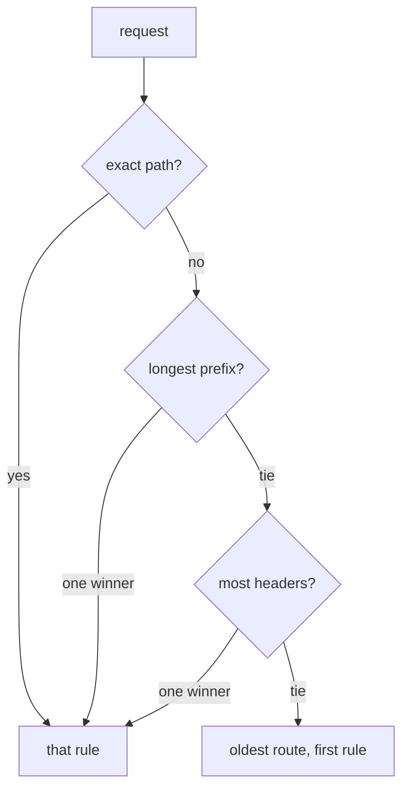

# Matches, Precedence And Weighted Backends

One route often has to serve several kinds of request. A request with a test header must reach the new version, every other request must reach the stable version, and a few paths need their own backend. The controller must choose exactly one rule for each request. This part explains how it chooses, and then shows how a single rule can share its traffic between two Services.

## How an HTTPRoute selects a rule

An `HTTPRoute` has a list of `rules`. Each rule has a list of `matches` and a list of `backendRefs`. A request matches a rule when it matches at least one entry in that rule's `matches`. One match entry can test the path, request headers, query parameters and the HTTP method, and the request must satisfy every test in the entry.

The path test has a type. `Exact` matches only the full path. `PathPrefix` matches the path and everything below it, split at the `/` characters, so `/echo` matches `/echo` and `/echo/probe` but not `/echoes`. A header test has a name and a value, and the type `Exact` compares the whole value.

Several rules can match the same request, for example the rule for `/` and the rule for `/echo`. The Gateway API defines the order. The controller does not read the list top to bottom. It applies these steps in turn and stops at the first one that finds a single winner:

1. A match with an `Exact` path wins over a match with a prefix path.
2. A match with a longer path wins over a match with a shorter one.
3. A match with an HTTP method wins over a match without one.
4. A match with more header tests wins.
5. A match with more query parameter tests wins.

If two matches are still equal, the oldest route wins (by creation time), and then the route that comes first in alphabetical order of namespace and name. Inside one route, the rule that comes first in the list wins. The controller (Envoy Gateway in the playground) converts the result into its proxy configuration, and the proxy then makes the choice for each request.



The diagram shows the order of the tests. The first test that separates the candidates decides, and later tests never run.

## A canary route with a header match

The `scout-v1` Service is the stable version and `scout-v2` is the new version. A request that carries the header `x-canary: true` must go to `scout-v2`. Every other request must go to `scout-v1`. Both rules use the path prefix `/`, so rule 4 decides: the match with the header test has more tests and wins when the header is present.

<!-- astrona:playground:renew -->

Save this as `httproute-scout.yaml`:

```yaml
apiVersion: gateway.networking.k8s.io/v1
kind: HTTPRoute
metadata:
  name: scout
  namespace: starfleet
spec:
  parentRefs:
    - name: edge
  hostnames:
    - scout.local
  rules:
    - matches:
        - path:
            type: PathPrefix
            value: /
          headers:
            - type: Exact
              name: x-canary
              value: "true"
      backendRefs:
        - name: scout-v2
          port: 80
    - matches:
        - path:
            type: PathPrefix
            value: /
      backendRefs:
        - name: scout-v1
          port: 80
```

Apply it:

```sh
kubectl apply -f httproute-scout.yaml
```

The route only works when the Gateway accepted it. Read the Gateway address and the conditions first. The address is the IP that the controller wrote into `.status.addresses` of the Gateway, and the pod `shuttle` can reach it:

```sh
GATEWAY=$(kubectl -n starfleet get gateway edge -o jsonpath='{.status.addresses[0].value}')
kubectl -n starfleet get httproute scout -o jsonpath='{range .status.parents[*].conditions[*]}{.type}={.status}{"\n"}{end}'
```

Both `Accepted` and `ResolvedRefs` must report `True`. Now send two requests with the host name `scout.local`, one without and one with the header. Each backend returns a JSON document, and its `message` field contains `v1` or `v2`:

```sh
kubectl -n starfleet exec deploy/shuttle -- curl -s -H "Host: scout.local" "http://$GATEWAY/"
kubectl -n starfleet exec deploy/shuttle -- curl -s -H "Host: scout.local" -H "x-canary: true" "http://$GATEWAY/"
```

The first request shows `v1`. The second shows `v2`. The `Host` header is what selects the route: the Gateway compares it with `hostnames` before it looks at any rule.

The header value matters. A request with `x-canary: yes` does not satisfy the `Exact` test, so rule 1 does not match and the default rule serves it. If you reverse the order of the two rules in the file, the result stays the same, because the header test gives the first rule more tests and the precedence list decides, not the position.

## Weighted backends

A header match sends a chosen group of requests to a version. A weight sends a share of all requests. Every entry in `backendRefs` has a `weight` field, an integer. The controller adds up the weights of the rule and sends each backend the share `weight / total`. The default weight is 1. Weights do not have to add up to 100.

Save this as `httproute-split.yaml`:

```yaml
apiVersion: gateway.networking.k8s.io/v1
kind: HTTPRoute
metadata:
  name: split
  namespace: starfleet
spec:
  parentRefs:
    - name: edge
  hostnames:
    - split.local
  rules:
    - backendRefs:
        - name: scout-v1
          port: 80
          weight: 90
        - name: scout-v2
          port: 80
          weight: 10
```

This rule has no `matches`. A rule without matches uses an implicit match of path prefix `/`, so it takes every request for `split.local`. Apply it, then send 40 requests and count the versions:

```sh
kubectl apply -f httproute-split.yaml
for i in $(seq 1 40); do kubectl -n starfleet exec deploy/shuttle -- curl -s -H "Host: split.local" "http://$GATEWAY/" | grep -o '"message": *"v[12]"'; done | sort | uniq -c
```

The count varies from run to run, because the proxy chooses a backend at random for each request. Expect about 36 requests for `v1` and about 4 for `v2`. A small number of requests gives a rough share, not an exact one.

A weight of 0 is valid. The backend stays in the route but receives no requests. This makes a controlled roll-out simple: start with weights 100 and 0, check that the route is accepted and the new backend resolves, and then raise the second weight in steps.

The weight applies per rule. If the canary header rule from the first route also had two backends, the weights would apply only inside that rule, after the rule has been chosen.

## What you know now

A request first selects the route by host name, then the rule by match precedence, and then the backend by weight. The controller makes the match decision from the fields of the rule, never from the order of the list alone. One question is open: after the rule is chosen, how can the route change the request, for example send a redirect or change the path? That is the job of filters.

## Common pitfalls

> [!WARNING]
> - Expecting the first rule in the list to win. The precedence list decides, and the position only breaks the last tie.
> - Writing a `PathPrefix` of `/echo/` or `/echo*`. Write `/echo`. The prefix is split at `/` characters, so `/echoes` does not match.
> - Forgetting the `Host` header in a test request. The Gateway returns a 404 response when no route has the host name.
> - Reading the weights as percentages. They are shares of the sum, so `3` and `1` give 75 and 25 percent.
> - Judging a split from five requests. Count at least 40.
