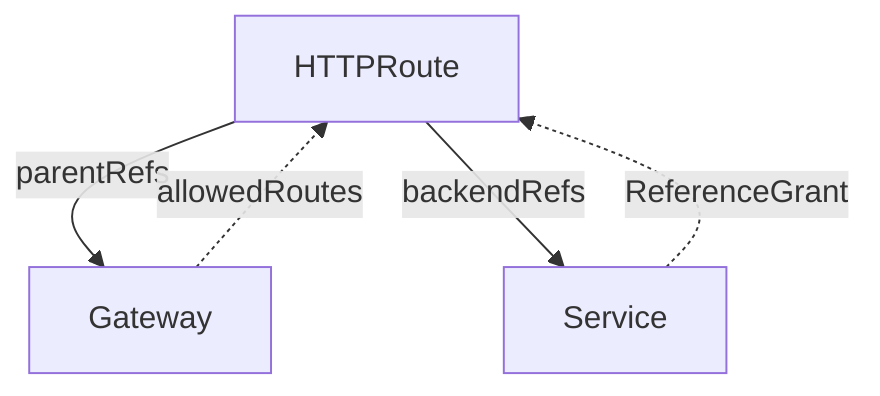

# Cross-Namespace Routes And ReferenceGrants

In a shared cluster, the team that owns the Gateway is often not the team that owns the applications. The application teams work in their own namespaces and write their own routes. The Gateway API has two separate permission checks for this: one decides which namespaces may attach routes to a Gateway, and the other decides which routes may use a Service in a different namespace. This part sets up both and reads the status reasons that report a refusal.

## Two directions, two owners

Two different references cross a namespace border, and each has its own owner and its own switch.

The first reference goes from a route to a Gateway, through `parentRefs`. The owner of the Gateway controls it with the `allowedRoutes` field of a listener. The field `namespaces.from` has three values: `Same` (only routes in the Gateway's namespace, the default), `All` (routes from every namespace) and `Selector` (routes from namespaces whose labels match a label selector).

The second reference goes from a route to a Service through `backendRefs`. A `backendRefs` entry may name a `namespace`. The owner of the Service controls this reference with a `ReferenceGrant`, a separate object that lives in the namespace of the Service. Without a matching grant, the controller refuses the reference.

The two switches are independent. A route may be allowed to attach and still be refused for a backend, and the other way round. Each refusal shows in a different condition with a different reason.



The solid arrows show the references the route holds. The dotted arrows show the permission that the owner of the target gives back.

## A route from another namespace is refused

The `outpost` namespace has a Service named `drifter`. A route in `outpost` that attaches to the Gateway `edge` in `starfleet` needs a `namespace` in its `parentRefs`, because the default namespace of a reference is the namespace of the route.

<!-- astrona:playground:renew -->

Save this as `httproute-drifter.yaml`:

```yaml
apiVersion: gateway.networking.k8s.io/v1
kind: HTTPRoute
metadata:
  name: drifter
  namespace: outpost
spec:
  parentRefs:
    - name: edge
      namespace: starfleet
  hostnames:
    - drifter.local
  rules:
    - backendRefs:
        - name: drifter
          port: 80
```

Apply it and read the `Accepted` condition:

```sh
kubectl apply -f httproute-drifter.yaml
kubectl -n outpost get httproute drifter -o jsonpath='{range .status.parents[*].conditions[*]}{.type}={.status} ({.reason}){"\n"}{end}'
```

The `Accepted` condition is `False` with the reason `NotAllowedByListeners`. The listener of `edge` allows routes from the same namespace only, so the controller refused the attachment. The route and the Service are both correct. The Gateway owner has not allowed the namespace.

## Allow a namespace with a label selector

A selector works on namespace labels, so the Gateway owner labels the namespaces that may attach and names the label in the listener. That keeps the decision with the owner of the Gateway: the owner of the route cannot change it by editing the route.

Save this as `gateway-edge.yaml`. It is the existing Gateway `edge` with the `allowedRoutes` field changed from `Same` to `Selector`:

```yaml
apiVersion: gateway.networking.k8s.io/v1
kind: Gateway
metadata:
  name: edge
  namespace: starfleet
spec:
  gatewayClassName: eg
  listeners:
    - name: http
      port: 80
      protocol: HTTP
      allowedRoutes:
        namespaces:
          from: Selector
          selector:
            matchLabels:
              gateway-access: allowed
```

Apply it and label the namespace `outpost`:

```sh
kubectl apply -f gateway-edge.yaml
kubectl label namespace outpost gateway-access=allowed
```

The controller watches both Gateways and namespaces, so it re-reads the route as soon as either changes. After a few seconds, read the `Accepted` condition again and the route counter on the Gateway. The counter `attachedRoutes` is the number of routes the listener accepted:

```sh
kubectl -n outpost get httproute drifter -o jsonpath='{.status.parents[0].conditions[?(@.type=="Accepted")].status}{"\n"}'
kubectl -n starfleet get gateway edge -o jsonpath='{.status.listeners[0].attachedRoutes}{"\n"}'
```

The condition is `True` now. The counter counts the routes that attached, which include the routes from `starfleet` that you created in earlier steps if they still exist. Note that the selector replaced the `Same` rule. A route in `starfleet` still attaches only when its own namespace has the label `gateway-access: allowed`, or when the selector allows it. Label `starfleet` as well if its routes must stay accepted.

## Reach a Service in another namespace

Attaching is only half of the problem. A route in `starfleet` may need a Service in `catalog`, for example a shared service that the catalog team owns. The route names the namespace in the `backendRef`.

Save this as `httproute-stock.yaml`:

```yaml
apiVersion: gateway.networking.k8s.io/v1
kind: HTTPRoute
metadata:
  name: stock
  namespace: starfleet
spec:
  parentRefs:
    - name: edge
  hostnames:
    - stock.local
  rules:
    - backendRefs:
        - name: stock
          namespace: catalog
          port: 80
```

Apply it, label `starfleet` so that the listener accepts the route, and read the conditions:

```sh
kubectl label namespace starfleet gateway-access=allowed
kubectl apply -f httproute-stock.yaml
kubectl -n starfleet get httproute stock -o jsonpath='{range .status.parents[*].conditions[*]}{.type}={.status} ({.reason}){"\n"}{end}'
```

The `Accepted` condition is `True`: the route may attach. The `ResolvedRefs` condition is `False` with the reason `RefNotPermitted`: the route may not use a Service in `catalog`. A request for `stock.local` returns an HTTP 500 response, because the proxy has a route without a usable backend.

The owner of the Service fixes this in the namespace of the Service. A `ReferenceGrant` lists who may refer (`from`) and what they may refer to (`to`). Save this as `referencegrant-stock.yaml`:

```yaml
apiVersion: gateway.networking.k8s.io/v1beta1
kind: ReferenceGrant
metadata:
  name: allow-starfleet-routes
  namespace: catalog
spec:
  from:
    - group: gateway.networking.k8s.io
      kind: HTTPRoute
      namespace: starfleet
  to:
    - group: ""
      kind: Service
      name: stock
```

The grant names the kind of object that refers (`HTTPRoute`) and its namespace, and the kind of object it may refer to (`Service`). The `name` field is optional. Without it, the grant covers every Service in `catalog`. The empty `group` means the core API group, where `Service` lives. Apply it and read the condition again:

```sh
kubectl apply -f referencegrant-stock.yaml
kubectl -n starfleet get httproute stock -o jsonpath='{.status.parents[0].conditions[?(@.type=="ResolvedRefs")].reason}{"\n"}'
```

The reason is `ResolvedRefs` now, and the status is `True`. Deleting the grant brings back `RefNotPermitted` within seconds. The grant has no effect on routes in other namespaces than the one in `from`, and it covers the Service reference only. It gives no permission to attach to a Gateway.

## What you know now

A Gateway owner controls which namespaces attach routes, with `allowedRoutes` and a namespace selector. A Service owner controls which namespaces may use the Service, with a `ReferenceGrant` in the Service namespace. The two refusals appear as `NotAllowedByListeners` in `Accepted` and `RefNotPermitted` in `ResolvedRefs`, so the reason tells you which owner to ask.

## Common pitfalls

> [!WARNING]
> - Putting the `ReferenceGrant` in the namespace of the route. It must be in the namespace of the Service.
> - Forgetting `namespace` in `parentRefs` for a route in another namespace. The controller looks for the Gateway in the namespace of the route.
> - Switching `from: Same` to `from: Selector` and forgetting to label the Gateway's own namespace. The routes that worked before are refused.
> - Reading only the `Accepted` condition. A route can be accepted and still have an unresolved backend.
> - Using `from: All` on a shared Gateway. Any team can attach a route to it.
