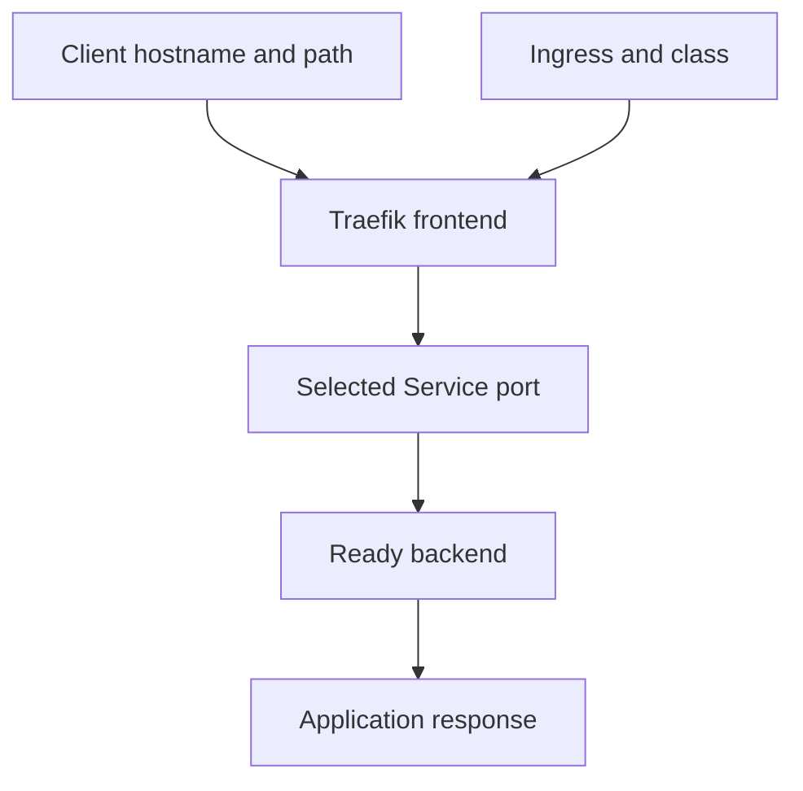

# Matching Ingress Hosts, Paths And Service Backends

A client requests `probe.local`, and Traefik chooses an Ingress route before forwarding to the `probe` Service. The Ingress object declares matching rules; the controller implements them. A rule stored without an active controller cannot provide the same routing behavior.

## Learning objectives

- Identify controller class and entry-point requirements.
- Compare host and path matching rules.
- Trace Service backend ports and TLS behavior.

## Before you start

You need the playground that runs Traefik in the `ingress-system` namespace, the `probe` Service in `starfleet` and the `shuttle` client Pod. A Pod is the Kubernetes unit for running one or more containers, and a namespace groups namespaced objects. The hands-on steps near the end of this chapter create one Ingress and send requests to it.

## Responsible components and behavior

An Ingress declares rules for routing external HTTP or HTTPS traffic to Services. HTTP means Hypertext Transfer Protocol; HTTPS is HTTP protected through Transport Layer Security (TLS). An Ingress controller interprets the resource and configures the actual traffic-handling infrastructure. Creating the resource without a suitable controller does not create a working external entry point.

## Identify The Controller Contract

An IngressClass identifies how an Ingress should be handled under the relevant configuration. The Ingress can select a class explicitly, while cluster defaults and controller behavior determine what happens when it does not. A controller listening for another class may ignore an otherwise valid resource.

Controller-specific annotations can affect behavior, but they are not universal Ingress semantics. A path rewrite supported by one controller cannot be assumed to work on every implementation. Begin with the standard host, path and backend model before relying on implementation extensions.

The controller itself also needs a reachable entry point, such as a provisioned load balancer or another appropriate network arrangement. An address in an Ingress status field is useful evidence, but it does not by itself prove that Domain Name System (DNS), client routing and application configuration all align.

## Follow Host And Path Selection

A host rule matches the request's host according to Ingress semantics. Sending a request to the controller address with an unrelated host can miss the intended rule. DNS maps the application's hostname to an entry address, while host routing selects which declared rule should handle the request. These are separate operations.

An `Exact` path type matches the declared path exactly. A `Prefix` path type matches using path elements rather than arbitrary text-prefix matching. For example, a prefix `/reports` can cover `/reports/daily` without necessarily matching `/reports-old` as the same path element. `ImplementationSpecific` delegates interpretation to the selected implementation.

Where several paths match, the supported precedence rules select the appropriate route, including preference for a longer match and exact matching at otherwise equivalent paths. A default backend can handle requests that do not match declared rules when configured. A default response from the controller is therefore different from an error emitted by the intended application backend.

## Resolve The Backend Port Relationship

A standard backend identifies a Service in the Ingress's namespace and a Service port by number or name. That reference is to the Service port, not directly to an arbitrary container port. The Service's own `targetPort` then maps the request toward its selected Pod endpoints.

Suppose the Service exposes port 80 and forwards to container port 8080. The Ingress backend references Service port 80, while the application must listen at the backend target. Pointing the Ingress to 8080 merely because the container uses that port can be incorrect if the Service exposes no such port.

The Service selector and endpoint readiness remain essential. A route can match the right host and path but still have no eligible backend. Ingress matching, Service selection, target-port mapping and application listening form a chain of independent relationships.

## TLS And Application Assumptions

A TLS configuration can reference a Secret containing certificate and key material in the expected namespace. The requested hostname should be covered by the certificate. A certificate for another name can fail client verification even when HTTP routing rules are otherwise correct.

TLS termination at the controller does not automatically mean the controller-to-backend connection is encrypted. That depends on the controller and backend configuration. Likewise, standard path matching does not universally rewrite the path passed to the application. A backend expecting `/` can return an error when it receives `/reports` unless the application or supported routing configuration handles that path.

The useful design exercise is to trace one request from hostname resolution through class selection, host and path matching, Service port selection and the ready backend. At each point, identify the declared rule and the responsible component. That sequence supports both a correct definition and a focused diagnosis.

## Work through the decision

An Ingress declares supported external web routing, including host, path and backend Service port. Its IngressClass identifies the controller contract. For this example, assume the cluster uses Traefik, which observes matching resources and serves the frontend connection. Inspect the class and controller before assuming that an accepted route is realized.

Transport Layer Security (TLS) can terminate at that frontend, using a certificate for the requested hostname. Certificate trust and hostname match are different checks from route matching. TLS on the frontend does not automatically encrypt the controller-to-Service hop. The basic practice backend uses plain Hypertext Transfer Protocol (HTTP), so describe this boundary explicitly rather than claiming end-to-end encryption.



The controller converts declared matching rules into a frontend-to-backend request path.

You can now separate route declaration, controller realization and connection security. A working external request still needs matching host and path, reachable backends and the intended certificate trust contract.

## Create a route and test host and path matching

Reading the rules is not enough. The next steps create one Ingress and send three requests that differ only in the Host header or the path. The `shuttle` Pod sends the requests, because its BusyBox `wget` command can set a Host header. The target is the `traefik` Service, the entry point of the controller.

<!-- astrona:playground:renew -->

Save this as `ingress-probe-demo.yaml`:

```yaml
apiVersion: networking.k8s.io/v1
kind: Ingress
metadata:
  name: probe-demo
  namespace: starfleet
spec:
  ingressClassName: traefik
  rules:
  - host: demo.local
    http:
      paths:
      - path: /reports
        pathType: Prefix
        backend:
          service:
            name: probe
            port:
              number: 80
```

Apply it:

```sh
kubectl apply -f ingress-probe-demo.yaml
```

Then check the result:

```sh
kubectl -n starfleet get ingress probe-demo
kubectl -n starfleet describe ingress probe-demo
```

The `describe` output lists the rule, the backend as the Service name and port, and the endpoints behind it. The Ingress API server accepted the object, but only the controller makes it work. The next commands send requests through the controller. The first request has the matching host and a path inside the prefix:

```sh
kubectl -n starfleet exec shuttle -- wget -qO- -T 3 --header 'Host: demo.local' http://traefik.ingress-system.svc/reports/daily
```

The response body comes from the `probe` application and starts with `version=v1`. Two things happened. Traefik matched the host `demo.local` and the prefix `/reports`, and the `probe` server answered a path that it does not define, because it answers every path with the same body. The path was not rewritten: the application received `/reports/daily`.

The next two requests must fail. The first has another host and the second has a path that only shares text with the prefix:

```sh
kubectl -n starfleet exec shuttle -- wget -qO- -T 3 --header 'Host: other.local' http://traefik.ingress-system.svc/reports
kubectl -n starfleet exec shuttle -- wget -qO- -T 3 --header 'Host: demo.local' http://traefik.ingress-system.svc/reports-old
```

BusyBox `wget` prints a `404 Not Found` error for each one and exits with a nonzero status. Both bodies come from Traefik, not from `probe`, because no rule matched. The path `/reports-old` fails because a `Prefix` rule compares whole path elements, and `reports-old` is a different element than `reports`.

The Ingress works for this host and path. A failing request shows which step broke only when you read the response body, the endpoints and the controller log together.

## Common pitfalls

> [!WARNING]
> An Ingress needs a matching controller and a reachable entry point. Match the Service's exposed port, distinguish prefix path elements from arbitrary string prefixes, and do not assume that path rewriting or backend encryption happens automatically.
