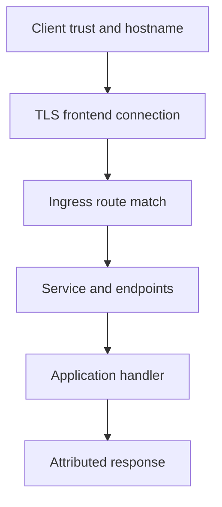

# Tracing An External Request To The Application

The frontend returns a routing error before the application logs a request. The request reached an intermediary, but that does not prove it reached `probe`. Diagnose hostname, path, certificate and backend selection as separate boundaries.

## Learning objectives

- Identify controller class and entry-point requirements.
- Compare host and path matching rules.
- Trace Service backend ports and TLS behavior.

## Before you start

You need the playground with Traefik, the `probe` Service in `starfleet` and the `shuttle` client Pod. A Pod is the Kubernetes unit for running one or more containers, and a namespace groups namespaced objects. The hands-on steps near the end of this chapter break a route in three ways and read the evidence each time.

## Responsible components and behavior

An external application request crosses several independently configured relationships. A client resolves a hostname, reaches an entry point, matches a route, reaches a Service backend and receives an application response. Diagnosing that path means finding the first relationship that fails, rather than changing every object that mentions the application's name.

## Begin With The Client Observation

A hostname resolution failure occurs before an ordinary request can reach the intended controller address. Domain Name System (DNS) records and client lookup behavior should be considered first. Changing a Deployment replica count cannot repair a missing external hostname record.

A connection timeout can mean the selected address is unreachable or filtered, or that the listener and network path do not accept the connection. It does not by itself identify a wrong Ingress path. Host and path routing decisions generally happen only after the request reaches an appropriate listener.

A certificate error concerns the secure connection contract. Transport Layer Security (TLS) verification can fail because the name, trust chain or validity does not satisfy the client. Ignoring verification may change a diagnostic observation but does not establish that the intended secure access has been configured correctly.

## Identify Who Produced The Response

A not-found response can come from the entry controller's default handling or from the application after a successful route. A server-side gateway error can reflect upstream connection failure rather than a process refusing an application operation. Status alone is therefore a clue; response identity and route or backend evidence help locate its source.

Check whether the selected Ingress belongs to the class handled by the running controller. A valid resource accepted by the application programming interface (API) server can still be ignored by that controller. Admission success and traffic configuration are different stages.

Compare the actual request host and path with the route. A test using only an address can send a host value different from the declared application hostname. An `Exact` rule for `/reports` does not behave like a prefix rule covering subordinate paths. The diagnostic request should represent the intended consumer's operation.

## Inspect Service And Endpoint Relationships

The Ingress backend refers to a Service and one of its exposed ports. That Service must select the intended Pods or use another valid backend arrangement. EndpointSlice resources describe Service backend information for supported cases. A Service with no ready eligible endpoints can exist and have the expected name while providing no useful application capacity.

A Pod readiness failure and a selector mismatch can both produce missing usable backends, but they have different corrections. If labels do not match, changing readiness thresholds will not select the Pod. If a correct Pod is unready because a dependency is absent, relabelling it will not make it safe to serve traffic.

Port names and numbers need consistent mapping. The Service's `port` belongs to the client-facing Service contract; `targetPort` identifies the backend listener according to its supported representation. A declared container port documents the Pod configuration but does not make the process bind that port.

## Examine The Remaining Network And Application Path

NetworkPolicy can control allowed connections to or from selected Pods when the network implementation enforces it. Evaluate the controller-to-backend source and the backend's applicable policies, not just an assumed external client address. Source representation can depend on the traffic path and implementation.

The application must listen on an address reachable through the Pod network. Listening only on loopback can support requests from another container in the same Pod while preventing ordinary requests to the Pod address. A successful local health test does not prove that the Service backend target is reachable.

Finally, inspect the path and protocol the application receives. A route match can deliver a path that the backend does not recognize, and TLS termination can leave a plain backend protocol unless additional configuration changes it. Correct the broken relationship while preserving the intended host, path and security contract. Then evaluate a meaningful application response, rather than only the existence of a network object.

## Work through the decision

Traefik can respond when no route matches or when its backend path fails. An application can also return an error after the controller successfully forwards to it. The response status alone does not identify the failing component. Compare route configuration, controller evidence, backend endpoints and application records.

For TLS, the client needs a certificate chain it trusts and a hostname covered by that certificate. The practice uses a local certificate with a Subject Alternative Name (SAN) for `probe.local`. The trusted matching name should succeed, while a different hostname should fail verification. Disabling verification would remove the property being tested. The local certificate is temporary practice trust, not a production public certificate deployment.



Frontend trust, route matching and backend processing can fail independently along one external request.

You can now attribute an external symptom to a specific request boundary. Repeat the intended hostname and operation with verification enabled after correcting the responsible setting.

## Break a route and read the evidence

The three experiments below each change one thing and read one source of evidence. They use an Ingress named `trace-demo` for host `trace.local`. The Ingress and the commands work on their own and need nothing from earlier steps.

<!-- astrona:playground:renew -->

Save this as `ingress-trace-demo.yaml`:

```yaml
apiVersion: networking.k8s.io/v1
kind: Ingress
metadata:
  name: trace-demo
  namespace: starfleet
spec:
  ingressClassName: traefik
  rules:
  - host: trace.local
    http:
      paths:
      - path: /
        pathType: Prefix
        backend:
          service:
            name: probe
            port:
              number: 80
```

Apply it:

```sh
kubectl apply -f ingress-trace-demo.yaml
```

Then send one request. It returns the `probe` body, which is the reference result for the experiments:

```sh
kubectl -n starfleet exec shuttle -- wget -qO- -T 3 --header 'Host: trace.local' http://traefik.ingress-system.svc/
```

The first experiment removes the endpoints. Scale the Deployment to zero Pods, wait a few seconds for Traefik to reload and send the same request:

```sh
kubectl -n starfleet scale deployment probe --replicas=0
kubectl -n starfleet get endpointslices -l kubernetes.io/service-name=probe
kubectl -n starfleet exec shuttle -- wget -qO- -T 3 --header 'Host: trace.local' http://traefik.ingress-system.svc/
```

The Ingress and the Service are unchanged, but the EndpointSlice has no ready address. This Traefik instance runs without the `allowEmptyServices` option, so it creates no route to a Service without endpoints and answers with its own 404 body. The error body comes from Traefik, not from the application, and the `probe` Pods log nothing. Restore the Pods before the next experiment:

```sh
kubectl -n starfleet scale deployment probe --replicas=2
kubectl -n starfleet rollout status deployment/probe
```

The second experiment reads the controller log. The Traefik log is the second source of evidence, next to the response body:

```sh
kubectl -n ingress-system logs deployment/traefik --tail=20
```

The log shows the controller side of the request path: configuration reloads and errors that Traefik found while it read the Ingress objects. When a client sees a 404 and the log shows an error about the Ingress or the Service, the fault is in the declared route, not in the application.

The third experiment requests the application directly, without the controller. This skips the Ingress rule and shows whether the backend itself answers:

```sh
kubectl -n starfleet exec shuttle -- wget -qO- -T 3 http://probe.starfleet.svc/
```

This request needs no Host header, because a Service has no host rules. If it returns `version=v1` while the request through the controller fails, the application and the Service are healthy, and the fault lies in the Ingress, the class or the controller. If it fails too, repair the Service or the Pods first.

You have now seen the three sources of evidence: the response body, the EndpointSlice and the controller log. The request path has more steps than one command can test, which is why the order of the checks matters more than any single command.

## Common pitfalls

> [!WARNING]
> Distinguish client lookup, transport, route matching, backend selection and application errors. A valid Ingress resource or Running Pod does not prove the full external request path works.
