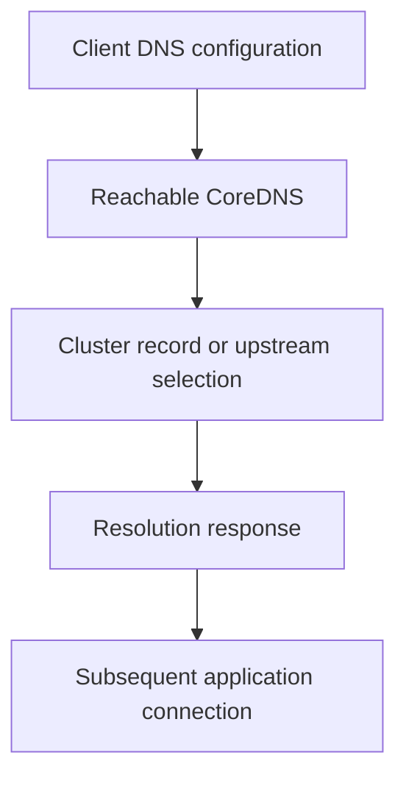

# CoreDNS Configuration And Cluster Name Resolution

A Pod resolves public names but not a Service name, while another Pod cannot reach the resolver at all. These symptoms point to different DNS boundaries.

## Learning objectives

- Explain Pod resolver settings and namespace search context.
- Identify Corefile and plugin responsibilities.
- Distinguish cluster lookup from upstream forwarding.

## Before you start

This chapter is standalone reading material; no running cluster or installed tools are required. A Pod is the Kubernetes unit for running one or more containers, and a namespace groups namespaced objects. Treat the worked configurations as teaching examples rather than recorded observations from a provisioned environment.

## Responsible components and behavior

CoreDNS is a DNS server commonly deployed to provide Kubernetes cluster name resolution. DNS means Domain Name System. Cluster naming helps applications discover Services and relevant endpoints, but the resolver, its configuration and the querying Pod's own DNS settings must form a usable path before a hostname becomes useful.

## The Query Path Has Several Parts

A Pod's DNS configuration can select a cluster resolver and search domains under its supported `dnsPolicy` and optional settings. Search domains let a short Service name be interpreted in an appropriate namespace context. An identical short name in another namespace can refer to a different destination.

A fully qualified Service name includes the Service name, namespace and cluster naming domain. The cluster domain is configurable, so assuming a remembered suffix applies to every installation can misidentify a valid resource. Compare the Pod's resolver configuration with the cluster's intended domain.

The DNS Service selects eligible resolver Pods through ordinary Service and endpoint relationships. If those endpoints are absent, name resolution can fail despite healthy application Pods. If restrictive network policy blocks queries to the resolver, the server can be running while a particular client cannot use it.

## Read The Corefile Responsibilities

CoreDNS uses a Corefile to describe server blocks and plugins. A Kubernetes plugin can answer supported cluster-resource names through API observations. A forwarding plugin can send suitable non-cluster queries to configured upstream resolvers. Other plugins can support caching, errors, logging or health behavior under their documented contracts.

Plugin configuration affects which zone is handled and how queries are processed. A syntax error can prevent startup or configuration use. A forwarding target that sends queries back into the same unresolved path can create a loop. Copying an upstream resolver setting without understanding the node's resolver arrangement can therefore introduce failure.

CoreDNS needs appropriate access to the Kubernetes resources used for discovery. A server process can start while its API watches fail through permission or endpoint problems. Distinguish a configuration parser failure, a denied resource watch and an upstream lookup failure when interpreting records.

## Services And Endpoints Have Different Naming Behavior

A normal ClusterIP Service commonly resolves to its Service address. A headless Service can provide supported endpoint-oriented answers instead. Those representations fit different application needs and should not be treated as interchangeable ways to locate one stable virtual address.

The names and answers depend on actual resources and endpoint conditions. A correct Service name does not prove its selected application backends are ready. Resolving a ClusterIP is evidence about discovery; reaching a useful application response requires the subsequent Service and Pod network path.

External names need their own upstream route and policy allowance. Successful cluster-local lookup does not prove that external hostname resolution is available, and successful external lookup does not prove the Kubernetes plugin can observe cluster resources. Use a relevant query for each responsibility.

## Diagnose By Comparison

If only one namespace fails to resolve a short name, examine search domains and resource scope. If many Pods fail every query, examine resolver Service endpoints, network access and CoreDNS operation. If cluster names work but external names fail, examine forwarding and upstream conditions.

A timeout means no usable answer arrived within the observer's limit, while a negative answer can mean the resolver reports the name does not exist under the queried context. These observations suggest different paths but still need server and client context. A policy that drops traffic can produce a timeout without proving that the resource name is absent.

After correction, evaluate both the intended lookup and the following application connection. This distinguishes restored naming from useful service reachability. Preserve the cluster domain and plugin responsibilities in the explanation so a temporary working query is not mistaken for proof that every discovery dependency is healthy.

## Work through the decision

CoreDNS is a DNS server commonly used for Kubernetes cluster discovery. Its configuration can supply cluster records and forward other requests to upstream resolvers. The client also needs correct DNS policy and search behavior plus network access to that server.

Separate record selection, resolver availability and upstream forwarding. A namespace-qualified Service name addresses client naming, not an unavailable resolver. An external lookup can fail through upstream forwarding while cluster discovery still works. Configuration changes can affect many workloads, so review the intended plugin behavior and verify representative internal and external queries before declaring a DNS repair complete.

Name resolution has its own client, server and upstream contracts and still does not establish backend health.

Name resolution has its own client, server and upstream contracts and still does not establish backend health.

## Common pitfalls

> [!WARNING]
> Resolver process health, DNS Service endpoints, API watches and upstream forwarding are separate conditions. Name resolution does not prove Service readiness or application connectivity.
