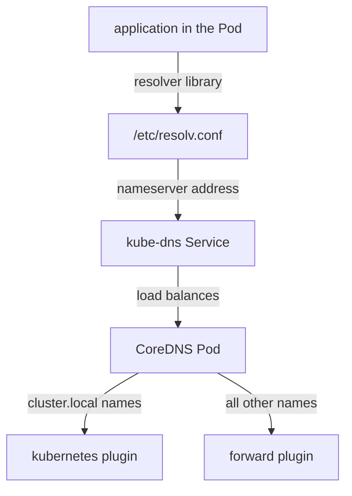

# From A Pod To An Answer: The Cluster Query Path

A Pod resolves public names but not a Service name, while another Pod cannot reach the resolver at all. Both symptoms look like "DNS is broken", but they come from different places on the path of a query. This chapter follows one query from the application to the answer, so that each later failure has a known place to look.

## What the Pod knows about DNS

DNS (Domain Name System) turns a name into an address. An application calls the resolver library of its container image, and the library reads the file `/etc/resolv.conf`. The kubelet, the node agent that starts the containers, writes that file when it creates the Pod. The Pod does not choose its DNS server; the Pod's `dnsPolicy` field does, and the default policy is `ClusterFirst`.

The first step is to read the file the kubelet wrote. The commands in this chapter run in the playground, and they use the `shuttle` Pod in the `starfleet` namespace.

<!-- astrona:playground:renew -->

```sh
kubectl -n starfleet exec shuttle -- cat /etc/resolv.conf
kubectl -n kube-system get service kube-dns
```

The file has three kinds of lines. The `nameserver` line holds the ClusterIP of the `kube-dns` Service, and the second command shows that same address in the `CLUSTER-IP` column. The `search` line holds three domains: `starfleet.svc.cluster.local`, `svc.cluster.local` and `cluster.local`. The `options` line holds `ndots:5`.

The Service is called `kube-dns` for historical reasons, and CoreDNS runs behind it. Every DNS query from every Pod with the default policy goes to this one ClusterIP, and the Service load-balances the queries over the CoreDNS Pods.

## How a short name becomes a full name

The `ndots` option sets a threshold. When a name has fewer dots than `ndots`, the resolver tries the search domains first and the name as written last. The name `probe` has no dots, so the resolver asks for `probe.starfleet.svc.cluster.local` first. That name exists, so the first query succeeds.

A fully qualified domain name (FQDN) for a Service has four parts: the Service name, the namespace, the label `svc` and the cluster domain. The default cluster domain is `cluster.local`, and an administrator can change it at cluster creation. The requests below use several valid forms of the name:

```sh
kubectl -n starfleet exec shuttle -- wget -q -T 3 -O- http://probe/
kubectl -n starfleet exec shuttle -- wget -q -T 3 -O- http://probe.starfleet/
kubectl -n starfleet exec shuttle -- wget -q -T 3 -O- http://probe.starfleet.svc.cluster.local/
kubectl -n outpost exec drifter -- wget -q -T 3 -O- http://probe/
kubectl -n outpost exec drifter -- wget -q -T 3 -O- http://probe.starfleet/
```

The first three commands reach the same Service from `shuttle`. The fourth command fails: the `drifter` Pod is in `outpost`, so its search list turns `probe` into `probe.outpost.svc.cluster.local`, and no Service with that name exists. The fifth command works, because `probe.starfleet` names the namespace. The search domains always start with the namespace of the Pod that asks. A short name is therefore safe only inside one namespace, and a request across namespaces needs `<service>.<namespace>`.

The commands use `wget` and not `nslookup` for short names, on purpose. The `wget` tool uses the resolver library of the image and so follows the search list, like an application does. The busybox `nslookup` tool sends the name exactly as typed and ignores the search list, so use it only with full names.



The diagram shows the path every query takes: the Pod sends it to the `kube-dns` ClusterIP, and a CoreDNS Pod decides between the cluster records and the upstream resolvers.

## What CoreDNS does with the query

CoreDNS is a DNS server written as a chain of plugins. It is configured in a file named the Corefile. In a cluster, the Corefile is stored in the ConfigMap `coredns` in the `kube-system` namespace, under the key `Corefile`. CoreDNS mounts this ConfigMap as a file in each of its Pods. Print the file the playground uses:

```sh
kubectl -n kube-system get configmap coredns -o jsonpath='{.data.Corefile}'
```

A typical default Corefile has one server block, `.:53`, which handles every name on port 53. The directives inside it are plugins. The `kubernetes` plugin is the one that makes CoreDNS a Kubernetes component: it watches Services and EndpointSlices in the API server and answers names that end in `cluster.local`. The `forward . /etc/resolv.conf` plugin sends every name the `kubernetes` plugin does not own to the resolvers listed in the node's `/etc/resolv.conf`.

Your Corefile can differ in small details from other clusters, because the installer writes it. The idea does not change: cluster names are answered from watched API objects, and everything else leaves the cluster through `forward`.

## Names outside the cluster

A name such as `example.com` does not end in `cluster.local`, so the `kubernetes` plugin does not answer it. The `forward` plugin sends the query to an upstream resolver and returns the answer to the Pod. The upstream resolvers come from `/etc/resolv.conf` on the node that runs the CoreDNS Pod, unless the Corefile lists addresses directly.

Because `example.com` has one dot and `ndots` is 5, the resolver first tries the search domains. It asks for `example.com.starfleet.svc.cluster.local`, then `example.com.svc.cluster.local`, then `example.com.cluster.local`. The `kubernetes` plugin answers each of these with "name does not exist", and only the last attempt, `example.com`, reaches the upstream. Each failed attempt is one extra query to CoreDNS. This is normal behaviour, not an error.

A fully qualified name that ends in a dot, such as `example.com.`, skips the search list. Use it when you test the upstream path, because it removes the search domains from the picture.

## What a successful lookup proves

A lookup of `probe.starfleet.svc.cluster.local` returns the ClusterIP of the Service. Compare it with the address that the Service holds:

```sh
kubectl -n starfleet get service probe
kubectl -n starfleet exec shuttle -- nslookup probe.starfleet.svc.cluster.local
kubectl -n starfleet exec shuttle -- wget -q -T 3 -O- http://probe/
```

The first two commands should show the same address. The third command is a separate test: it checks that a Pod behind the Service answers on the port. A name can resolve to a Service without ready Pods, and then the lookup succeeds while the request times out. The lookup tests the naming, and the request tests the path to the backend.

The reverse also holds. A request by a fixed IP address works while DNS is broken, because the resolver is not involved. That is a useful test: when the address works and the name does not, the fault is in the DNS path and not in the application.

This chapter showed that a Pod's resolver file, the `kube-dns` Service and the Corefile form one chain. The open question is what happens when one link breaks, and how a failure looks from the client. The next chapter answers that with a broken Corefile.

## Common pitfalls

> [!WARNING]
> A short name depends on the namespace of the client. `probe` in `starfleet` and `probe` in `outpost` are different Services, so do not copy a short name into a workload in another namespace and expect the same backend. Do not assume the domain is `cluster.local` in every cluster: read the `search` line of a Pod first.
