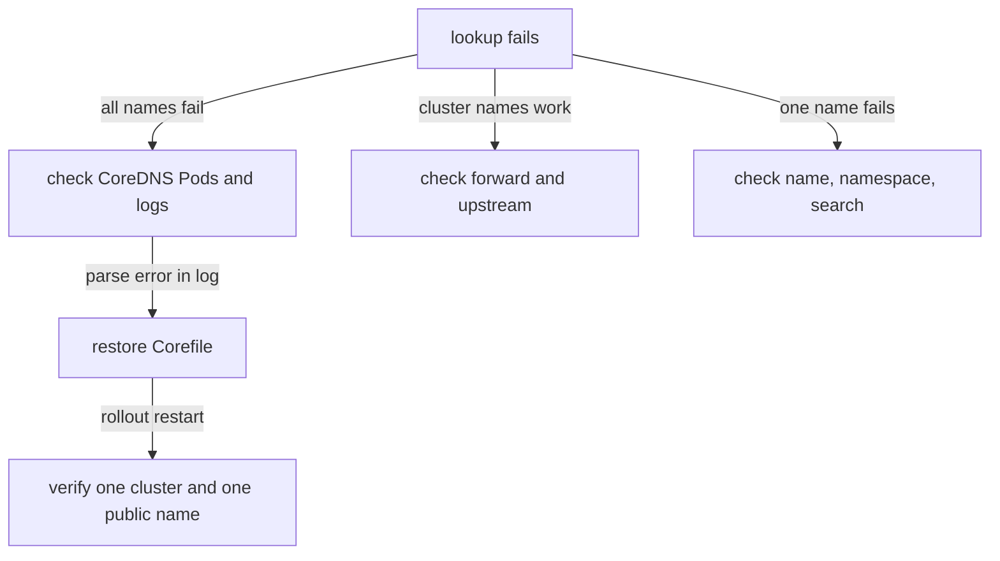

# Corefile Errors And How To Repair Them

CoreDNS reads its whole configuration from one text file. A single wrong line in that file can stop every new CoreDNS Pod from starting, and then the cluster slowly loses name resolution. This chapter shows what such a failure looks like from the client, from the Pods and from the logs, and the repair steps in the order an administrator runs them.

## How a Corefile change reaches the Pods

The Corefile lives in the ConfigMap `coredns` in `kube-system`. The kubelet mounts the ConfigMap as a file into each CoreDNS Pod, and the CoreDNS process reads that file at start. The ConfigMap is a separate object from the Deployment. Editing the ConfigMap does not restart any Pod.

Two things then happen. The `reload` plugin in the default Corefile checks the file about every 30 seconds and loads a changed file without a restart; the kubelet also needs some time to refresh the mounted file, so a change can take about two minutes to arrive. A new Pod, for example after a restart, reads the file once at start. When the new file has a syntax error, the `reload` plugin logs the error and the running process keeps its old configuration, but a new process cannot start at all.

## Make a backup before any change

Save the current Corefile to a local file first. The backup is the only copy you can restore exactly, because an edit in the ConfigMap replaces the old text.

<!-- astrona:playground:renew -->

```sh
kubectl -n kube-system get configmap coredns -o jsonpath='{.data.Corefile}' > Corefile.backup
kubectl -n kube-system get deployment coredns
kubectl -n kube-system get pods -l k8s-app=kube-dns
```

The Deployment normally has two replicas. Both Pods carry the label `k8s-app=kube-dns`, the same label that the `kube-dns` Service selects, which is why the old name is still in use.

## Break the Corefile and watch the symptoms

Open the ConfigMap in your editor with `kubectl -n kube-system edit configmap coredns`, add a new line `invalid_directive` below the line `loop` inside the `.:53` block, and save. Then restart the Deployment, which creates new Pods that read the file at start:

```sh
kubectl -n kube-system rollout restart deployment/coredns
kubectl -n kube-system get pods -l k8s-app=kube-dns
```

The new Pod does not reach `Ready`. Its status moves to `Error` and then `CrashLoopBackOff`, which means the container exits and the kubelet restarts it with a growing delay. The Deployment uses a rolling update, so it keeps one old Pod until the new Pod is ready. The old Pod still answers queries, so name resolution works for now, but there is no healthy replacement.

The log of the failed Pod names the problem. A parse error line starts with `Error during parsing` and names the directive that CoreDNS does not know:

```sh
kubectl -n kube-system logs -l k8s-app=kube-dns --tail=20
```

The `--tail=20` option limits the output to the last 20 lines of each Pod. The log is the main source of truth for a Corefile error, because the Pod phase only says that the container exited.

## Tell the failure from other DNS failures

A Corefile error and a missing resolver have different effects on a client. When all CoreDNS Pods are gone, every lookup times out. When one old Pod is still ready, lookups work but nothing new can start. When the Corefile is valid but wrong, for example a wrong zone in a `forward` line, the Pods are ready and only some names fail.



The diagram shows that the first question is how many names fail, and that a parse error in the log leads to a restore and a restart.

## Restore the Corefile and restart the Deployment

The repair has three steps: put back a valid Corefile, restart the Deployment so that every Pod reads it, and verify. Create a ConfigMap file from the backup and apply it:

```sh
kubectl -n kube-system create configmap coredns --from-file=Corefile=Corefile.backup --dry-run=client -o yaml > coredns-restore.yaml
kubectl apply -f coredns-restore.yaml
kubectl -n kube-system rollout restart deployment/coredns
kubectl -n kube-system rollout status deployment/coredns --timeout=120s
```

The `--dry-run=client` option builds the object on your machine and does not send it, and the redirect saves it as a file. `kubectl apply` may warn that the object lacks the last-applied annotation, because the installer created it with another method; the warning does not stop the change. The `rollout status` command waits until every new Pod is ready.

Verify one cluster name and the path to the backend:

```sh
kubectl -n starfleet exec shuttle -- nslookup probe.starfleet.svc.cluster.local
kubectl -n starfleet exec shuttle -- wget -q -T 3 -O- http://probe/
```

The first command tests the `kubernetes` plugin. The second tests the whole path to the backend. If your cluster has outbound DNS access, also look up a public name with `nslookup example.com.` from the same Pod to test the `forward` plugin.

This chapter showed that a Corefile error appears in the logs of the new Pods and that the repair is a restore plus a restart. A habit remains: take the backup before every edit, and verify with one cluster name and one public name afterwards.

## Common pitfalls

> [!WARNING]
> Do not edit the ConfigMap without a backup, and do not assume a change is live because the ConfigMap shows it: check the Pod logs and the rollout status. A Pod in `Running` status can still run an old configuration. Do not delete the `coredns` Deployment to force a restart; use `kubectl rollout restart`, which replaces the Pods one at a time.
