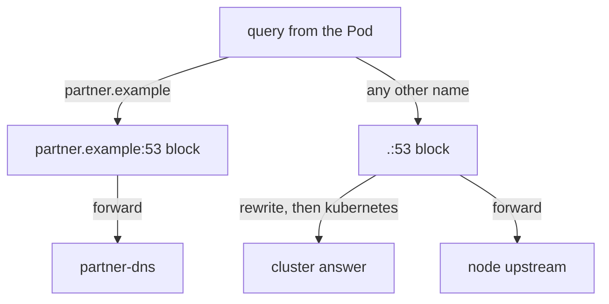

# Corefile Plugins, Stub Domains And Rewrite

A cluster rarely lives alone. Pods must resolve names that a partner or a company network owns, and some old software uses names that no Service has. The Corefile solves both cases, but only if you know which plugin does which job. This chapter reads a Corefile line by line, and then adds a stub domain and a rewrite rule.

## A Corefile is server blocks that contain plugins

A server block starts with a zone and a port, such as `.:53`, and holds a list of plugins in braces. The zone `.` means every name. CoreDNS picks the server block with the longest zone that matches the name in a query, so a block for `partner.example:53` wins over `.:53` for names that end in `partner.example`.

The order of the plugin lines inside a block does not set the order in which they run. CoreDNS compiles a fixed plugin order into its binary, and the file only chooses which plugins are on. Print the Corefile of the playground first:

<!-- astrona:playground:renew -->

```sh
kubectl -n kube-system get configmap coredns -o jsonpath='{.data.Corefile}'
```

A typical default block turns on these plugins:

| Plugin | What it does |
| --- | --- |
| `errors` | Writes errors to the standard output of the Pod |
| `health` | Serves a health endpoint (port 8080, path `/health`); `lameduck 5s` delays shutdown by five seconds |
| `ready` | Serves a readiness endpoint (port 8181, path `/ready`) that is OK when all plugins are ready |
| `kubernetes` | Answers names in `cluster.local` from Services, EndpointSlices and Pods |
| `forward` | Sends all other names to upstream resolvers |
| `cache` | Keeps answers for a number of seconds |
| `loop` | Stops CoreDNS when it detects a forwarding loop |
| `reload` | Loads a changed Corefile without a restart |
| `loadbalance` | Randomises the order of address records in an answer |

The kubelet uses the `ready` endpoint in the readiness probe of the CoreDNS Pods, and the `health` endpoint in the liveness probe. A plugin that fails to start therefore keeps the Pod out of the `kube-dns` Service.

## The forward plugin and the loop plugin

The `forward` plugin has a zone and a list of targets: `forward . /etc/resolv.conf` uses the resolvers that are listed in the `resolv.conf` file of the node, and `forward . 10.0.0.53` uses one address. A CoreDNS Pod that forwards to itself would send a query in a circle forever. This happens when the node's `resolv.conf` points at a local resolver that in turn points at CoreDNS. The `loop` plugin sends a test query at start, detects the circle and stops the process, so that a broken configuration shows as a crash and not as a hang.

## Add a stub domain

A stub domain is a zone that another DNS server owns. The cluster does not copy its records. It forwards the queries for that zone to that server. In the playground, the Service `partner-dns` answers the zone `partner.example`. A query now fails, because the default block sends it to the node's upstream resolvers:

```sh
kubectl -n starfleet exec deploy/shuttle -- nslookup relic.partner.example.
```

Read the address of the partner server, which the Corefile needs:

```sh
kubectl -n starfleet get service partner-dns -o jsonpath='{.spec.clusterIP}'
```

The next file replaces the `coredns` ConfigMap. It repeats the default block and adds a second block for the zone. Replace `<PARTNER>` with the address from the last command, and compare the first block with the Corefile you printed: if your cluster has other lines in it, keep your lines. Save this as `coredns-configmap.yaml`:

```yaml
apiVersion: v1
kind: ConfigMap
metadata:
  name: coredns
  namespace: kube-system
data:
  Corefile: |
    .:53 {
        errors
        health {
           lameduck 5s
        }
        ready
        kubernetes cluster.local in-addr.arpa ip6.arpa {
           pods insecure
           fallthrough in-addr.arpa ip6.arpa
           ttl 30
        }
        prometheus :9153
        forward . /etc/resolv.conf {
           max_concurrent 1000
        }
        cache 30
        loop
        reload
        loadbalance
    }
    partner.example:53 {
        errors
        cache 30
        forward . <PARTNER>
    }
```

Apply it and restart CoreDNS so that every Pod reads it at once:

```sh
kubectl apply -f coredns-configmap.yaml
kubectl -n kube-system rollout restart deployment/coredns
kubectl -n kube-system rollout status deployment/coredns --timeout=120s
```

Then check both zones:

```sh
kubectl -n starfleet exec deploy/shuttle -- nslookup relic.partner.example.
kubectl -n starfleet exec deploy/shuttle -- nslookup probe.starfleet.svc.cluster.local
```

The first lookup returns `192.0.2.10`, which the partner server holds. The second returns the ClusterIP of the Service `probe`. The `kubectl apply` command may warn about a missing last-applied annotation, because the installer created the object another way. The warning does not stop the change.

## Rewrite a name to a Service

The `rewrite` plugin changes the name in a query before the other plugins see it. With the type `exact` it also changes the name in the answer back, so the client sees the name it asked for. In the `.:53` block, the line below makes `deck.fleet.internal` answer with the address of the Service `bridge`:

```
rewrite name exact deck.fleet.internal bridge.starfleet.svc.cluster.local
```

Add the line as the first line of the `.:53` block in `coredns-configmap.yaml`, apply the file again, restart the Deployment and look up `deck.fleet.internal.` from `shuttle`. The `kubernetes` plugin receives the rewritten name, finds the Service and returns its ClusterIP.



The diagram shows that the zone in a server block chooses the block, and that the plugins of the block then choose between cluster records and forwarding.

A stub domain and a rewrite rule are the two most common Corefile changes. Both leave the default block alive, so cluster names keep working. What is left is the Pod side of DNS: a query only reaches CoreDNS in the form that the Pod's resolver builds.

## Common pitfalls

> [!WARNING]
> Replacing the whole Corefile with only the new block removes the `kubernetes` plugin, and every cluster name fails. Keep the default block. A change in the ConfigMap is not live until the `reload` plugin loads it or you restart the Deployment, and a parse error then keeps new Pods from starting, so read the logs after each restart. A `forward` target must be an address that the CoreDNS Pods can reach.
