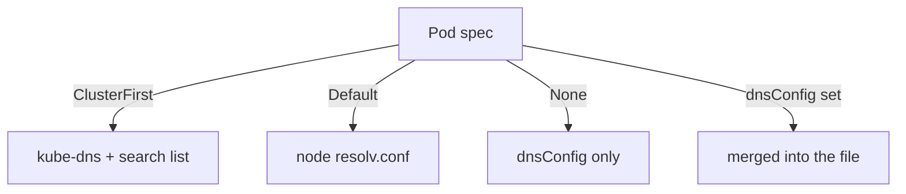

# Pod DNS Policy, dnsConfig, ndots And Search Domains

A Pod's name lookups depend on one small file, `/etc/resolv.conf`, which the kubelet writes when it creates the Pod. Slow lookups, lookups that reach the wrong server and short names that fail all trace back to that file. This chapter shows the fields that control it and the exact effect of each.

## What the kubelet writes

The Pod field `spec.dnsPolicy` tells the kubelet how to build the file. There are four values:

- `ClusterFirst` is the default. The `nameserver` line points at the `kube-dns` Service, and the search list holds the cluster domains. Names that do not match the cluster domain go to CoreDNS and then upstream.
- `ClusterFirstWithHostNet` has the same effect for a Pod with `hostNetwork: true`. Without it, a host-network Pod with the default policy falls back to the policy `Default`.
- `Default` is a confusing name: it does not mean the default. The Pod inherits the `resolv.conf` of the node it runs on, so it bypasses CoreDNS and cannot resolve Service names.
- `None` ignores all cluster settings. The Pod uses only what `spec.dnsConfig` says, and the Pod is rejected when `dnsConfig` has no name server.

Read the file for the `shuttle` client of the playground:

<!-- astrona:playground:renew -->

```sh
kubectl -n starfleet exec deploy/shuttle -- cat /etc/resolv.conf
```

It has one `nameserver` line with the ClusterIP of `kube-dns`, a `search` line with `starfleet.svc.cluster.local svc.cluster.local cluster.local` and the line `options ndots:5`. A node may add more search domains from its own `resolv.conf`.

## ndots decides how many queries a name costs

The resolver library of the container counts the dots in a name. When the count is lower than `ndots`, the resolver treats the name as relative and tries each search domain first. When the count is equal to or higher than `ndots`, it tries the name as written first and the search domains after it.

With `ndots:5`, the name `relic.partner.example` has two dots, so the resolver asks for `relic.partner.example.starfleet.svc.cluster.local`, then `relic.partner.example.svc.cluster.local`, then `relic.partner.example.cluster.local`, and only then for the real name. CoreDNS answers the first three with "name does not exist" and the client waits for each answer. A client that calls many external names pays this cost on every lookup.

There are two fixes. A name that ends with a dot, such as `relic.partner.example.`, is absolute and skips the search list. A lower `ndots` in the Pod makes names with enough dots absolute at the first try. The price of a lower value is that short, multi-part Service names such as `probe.starfleet` (one dot) still work with `ndots:2`, but a name with two dots that is meant as a Service path, such as `a.b.c`, would be tried as an external name first.

## Change the options with dnsConfig

The field `spec.dnsConfig` has three lists. `nameservers` holds up to three IP addresses. `searches` holds extra search domains. `options` holds resolver options as name and value pairs, such as `ndots`. For the policy `ClusterFirst`, the kubelet merges these lists into the generated file, so `dnsConfig` adds to the cluster settings and does not replace them.

The `shuttle` Pod is created by a Deployment, so the change belongs in the Pod template of the Deployment. Save this as `shuttle-dnsconfig.yaml`:

```yaml
spec:
  template:
    spec:
      dnsConfig:
        options:
          - name: ndots
            value: "2"
```

Apply it as a patch. The patch changes the Pod template, so the Deployment starts a rollout and the new Pod gets a new file:

```sh
kubectl -n starfleet patch deployment shuttle --patch-file shuttle-dnsconfig.yaml
kubectl -n starfleet rollout status deployment/shuttle --timeout=120s
kubectl -n starfleet exec deploy/shuttle -- cat /etc/resolv.conf
```

The `options` line now reads `ndots:2`, and the `nameserver` and `search` lines are the same as before. A running Pod keeps its old file: the kubelet writes the file once, so only Pods created after the change see it.

## A Pod with its own resolver

The policy `None` gives a Pod a resolver that has nothing to do with the cluster. It fits a Pod that must use only a partner DNS server. The Pod below uses the `partner-dns` Service as its only name server. Read the address first and put it in the file:

```sh
kubectl -n starfleet get service partner-dns -o jsonpath='{.spec.clusterIP}'
```

Save this as `pod-isolated.yaml`, with `<PARTNER>` replaced by that address:

```yaml
apiVersion: v1
kind: Pod
metadata:
  name: isolated
  namespace: starfleet
spec:
  dnsPolicy: None
  dnsConfig:
    nameservers:
      - <PARTNER>
    options:
      - name: ndots
        value: "1"
  containers:
    - name: isolated
      image: busybox:1.37.0
      command: ["sh", "-c", "sleep 3600"]
```

Apply the file and look up one name from each world:

```sh
kubectl apply -f pod-isolated.yaml
kubectl -n starfleet wait --for=condition=Ready pod/isolated --timeout=60s
kubectl -n starfleet exec isolated -- nslookup relic.partner.example.
kubectl -n starfleet exec isolated -- nslookup probe.starfleet.svc.cluster.local
```

The first lookup works, because the only name server is the partner server. The second lookup fails: the partner server has no record of the Service, and the Pod no longer asks CoreDNS. This is the cost of the policy `None`: the Pod loses cluster discovery.



The diagram shows that the policy chooses the base of the file and that `dnsConfig` is merged on top, except for the policy `None`, where it is the whole file.

You now know where the file comes from and which field changes each line. What remains is the other side of the name: which DNS records Kubernetes publishes for headless Services and StatefulSet Pods.

## Common pitfalls

> [!WARNING]
> The policy `Default` does not mean "the default": it bypasses CoreDNS. Editing `dnsConfig` in a running Pod is not possible, and a Deployment needs a rollout before new Pods carry the change. A policy `None` Pod without a name server in `dnsConfig` is rejected. A very low `ndots` can send an in-cluster multi-dot name to the upstream resolvers first.
