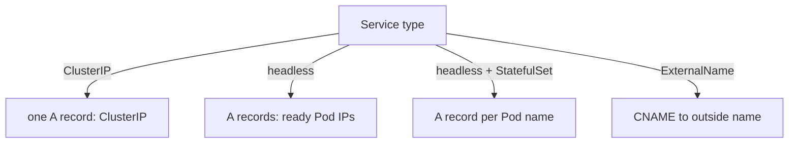

# DNS Records For Headless Services And StatefulSet Pods

A normal Service hides its Pods behind one address. Some applications need the opposite: a database cluster must contact member number 0 by name, and a client library must see every backend address. Kubernetes publishes different DNS records for these cases. This chapter lists the records, shows which Service setting creates each one, and shows how to read them.

## One name, one address: the ClusterIP Service

A Service with a ClusterIP gets one A record (an IPv4 address record) named `<service>.<namespace>.svc.cluster.local`. The record holds the ClusterIP. The kube-proxy component on each node then spreads the connections over the ready Pods. The client never sees a Pod address.

A Service of type `ExternalName` gets a CNAME record (a canonical name record, which says that one name is an alias for another). It has no ClusterIP and no proxying. The client receives the alias target and resolves that name itself.

## One name, many addresses: the headless Service

A Service is headless when its field `spec.clusterIP` is `None`. CoreDNS answers a lookup of its name with one A record for each ready Pod that the selector matches, and the client chooses one. The playground has a headless Service `crew` and a StatefulSet `crew` with two Pods. Look up the Service name from the client:

<!-- astrona:playground:renew -->

```sh
kubectl -n starfleet get service crew
kubectl -n starfleet exec deploy/shuttle -- nslookup crew.starfleet.svc.cluster.local
```

The `CLUSTER-IP` column shows `None`, and the lookup lists two addresses, one for each Pod. Compare this with the lookup of the ClusterIP Service `probe`, which lists one address.

Only ready Pods appear in the answer. A Pod whose readiness probe fails is left out, unless the Service sets `publishNotReadyAddresses: true`. This is useful for a clustered database that must find its members before they are ready.

## One name per Pod: the StatefulSet

A StatefulSet gives each Pod a stable name: `crew-0`, `crew-1`. When the StatefulSet field `serviceName` names a headless Service, CoreDNS publishes one record per Pod in the form `<pod>.<service>.<namespace>.svc.cluster.local`. The name stays the same when the Pod restarts, while the Pod IP can change.

```sh
kubectl -n starfleet get pods -l app=crew -o wide
kubectl -n starfleet exec deploy/shuttle -- nslookup crew-0.crew.starfleet.svc.cluster.local
```

The address in the lookup is the Pod IP of `crew-0`. The record exists only when the governing Service is headless. With an ordinary ClusterIP Service in its place, the per-Pod names are not published, and a lookup of `crew-0.crew` returns "name does not exist". The StatefulSet itself looks healthy in that case, which makes the fault easy to miss.

## SRV records for named ports

An SRV record (a service record) gives a host name and a port for a named port of a Service. The name has the form `_<port-name>._<protocol>.<service>.<namespace>.svc.cluster.local`. The Service `crew` names its port `http`, so the record name is `_http._tcp.crew.starfleet.svc.cluster.local`. For a headless Service the answer holds one entry for each Pod, with the Pod's own name.

```sh
kubectl -n starfleet exec deploy/shuttle -- nslookup -type=SRV _http._tcp.crew.starfleet.svc.cluster.local
```

Clients that use SRV records learn the port from DNS, so a change of the port number needs no change in the client. Most web clients do not use SRV records, so the records matter mainly for specific software and for exam questions.

## Pod A records

With the setting `pods insecure` in the `kubernetes` plugin, which the default Corefile uses, CoreDNS also answers a name made from a Pod IP: the IP with dashes, the namespace, the label `pod` and the cluster domain. For the Pod IP `10.244.1.5` in `starfleet`, the name is `10-244-1-5.starfleet.pod.cluster.local`. The record is not checked against a real Pod, which is why the setting is called insecure. Read a real address and look it up:

```sh
POD_IP=$(kubectl -n starfleet get pod crew-0 -o jsonpath='{.status.podIP}')
kubectl -n starfleet exec deploy/shuttle -- nslookup "$(echo "$POD_IP" | tr . -).starfleet.pod.cluster.local"
```

The lookup returns the same Pod IP that you used to build the name. These names do not identify a Pod when it restarts, so use them for tests only.

## An ExternalName Service

An ExternalName Service points a cluster name at an outside name. Save this as `service-externalname.yaml`:

```yaml
apiVersion: v1
kind: Service
metadata:
  name: ledger
  namespace: starfleet
spec:
  type: ExternalName
  externalName: relic.partner.example
```

Apply it and look up the Service name:

```sh
kubectl apply -f service-externalname.yaml
kubectl -n starfleet exec deploy/shuttle -- nslookup ledger.starfleet.svc.cluster.local
```

CoreDNS answers with a CNAME to `relic.partner.example`. The playground cluster cannot follow the alias to an address unless the zone `partner.example` is forwarded to the partner server, so the lookup result depends on the Corefile. The `forward` rules decide whether the alias target resolves.



The diagram shows that the Service type, not the Pod, decides which DNS records exist.

You now know which Service setting creates each record. The remaining question is what to do when the records are right but the answers are slow or missing, which is a question about CoreDNS itself.

## Common pitfalls

> [!WARNING]
> A StatefulSet needs a headless Service with the name given in `serviceName`, or the per-Pod names do not exist. The field `clusterIP` cannot be changed on an existing Service, so turning a ClusterIP Service into a headless one means deleting and recreating it. Not ready Pods are missing from the answer. Do not use the dashed Pod IP names in application configuration.
