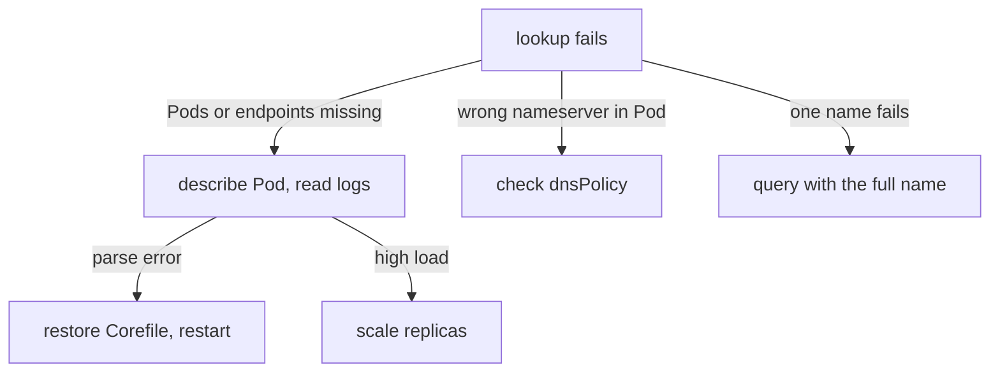

# Scaling And Debugging CoreDNS

Every Pod in the cluster sends its lookups to CoreDNS, so a slow or missing CoreDNS slows or stops the whole cluster. This chapter shows how to check that CoreDNS is healthy, how to see the queries that reach it, how to add replicas and how to apply a configuration change safely.

## Check the three links in order

A failing lookup has three possible places: the Pod's resolver file, the path to CoreDNS and CoreDNS itself. Check them in that order, because each check is short.

First, check that the CoreDNS Pods run and that the `kube-dns` Service has endpoints. A Service without ready endpoints answers no query, even when the Pods exist.

<!-- astrona:playground:renew -->

```sh
kubectl -n kube-system get deployment coredns
kubectl -n kube-system get pods -l k8s-app=kube-dns -o wide
kubectl -n kube-system get endpointslices -l kubernetes.io/service-name=kube-dns
```

The Deployment shows how many replicas are ready. The EndpointSlice lists the addresses of the ready Pods on the DNS ports. When the Deployment shows `0/2` ready, read the Pod events with `kubectl -n kube-system describe pod` and the log with `kubectl -n kube-system logs`. A parse error in the log means the Corefile is wrong. A `loop` message means the forward target sends queries back to CoreDNS.

Second, check the client. Read `/etc/resolv.conf` in the failing Pod and make sure the `nameserver` address equals the `kube-dns` ClusterIP. A Pod with the policy `Default` or `None` has another address, and then CoreDNS never sees its queries.

Third, send one query by hand from a client, with the full name, to remove the search list from the picture:

```sh
kubectl -n starfleet exec deploy/shuttle -- nslookup probe.starfleet.svc.cluster.local
```

If this works while the application's own name fails, the problem is the name the application uses, not CoreDNS.

## Turn on query logging

The `log` plugin writes one line for every query that reaches the server block. It is off in the default Corefile, because a busy cluster produces many lines. Turn it on for a debugging session and off again afterwards. Open the ConfigMap, add the line `log` in the `.:53` block next to `errors`, and save:

```sh
kubectl -n kube-system edit configmap coredns
kubectl -n kube-system rollout restart deployment/coredns
kubectl -n kube-system rollout status deployment/coredns --timeout=120s
```

Send a lookup from the client and read the logs of all CoreDNS Pods. Use the `--prefix` option so that each line names its Pod, because the Service sends each query to one of the Pods:

```sh
kubectl -n starfleet exec deploy/shuttle -- nslookup probe.starfleet.svc.cluster.local
kubectl -n kube-system logs -l k8s-app=kube-dns --prefix --tail=20
```

Each logged line shows the client address, the query type and name, the response code and the time taken. A response code `NXDOMAIN` means the name does not exist. A code `SERVFAIL` means CoreDNS could not get an answer, for example because an upstream did not respond. A code `NOERROR` with no address means the name exists but has no record of the asked type. Remove the `log` line again when you finish.

## Apply a configuration change safely

The ConfigMap is not part of the Deployment, so a change in the ConfigMap does not restart the Pods. The `reload` plugin loads a changed file after a delay of about one to two minutes. For a predictable result, use this sequence: save a backup of the Corefile, edit the ConfigMap, run `kubectl rollout restart deployment/coredns`, wait with `kubectl rollout status`, and test one cluster name and one outside name.

The rolling update replaces the Pods one at a time. A bad Corefile therefore stops the rollout at the first new Pod, while the old Pods keep answering. This gives time to restore the backup, and it is the reason to restart after a change and not to delete the Pods.

## Add replicas

The default Deployment has two replicas. Each Pod uses little memory, and a cluster with many Pods or many lookups needs more. Scale the Deployment by hand, and check that the new Pods are ready and in the EndpointSlice:

```sh
kubectl -n kube-system scale deployment coredns --replicas=3
kubectl -n kube-system rollout status deployment/coredns --timeout=120s
kubectl -n kube-system get endpointslices -l kubernetes.io/service-name=kube-dns
```

Some clusters run a DNS autoscaler, a separate Deployment that sets the replica count from the number of nodes or cores. When one runs, a manual scale is reset by the autoscaler, so change its settings and not the replica count. The playground has no autoscaler.

More replicas help only when the load is the cause. If the Pods are crashing on a parse error, more replicas give more crashing Pods. Match the fix to the cause that the logs show.



The diagram shows that the symptom picks the check, and that the logs then pick between a restore and a scale-up.

You now have a repeatable method: check the Pods and endpoints, check the client file, query by hand, read the log, then change one thing and restart. The method applies to any DNS fault, whatever the plugin.

## Common pitfalls

> [!WARNING]
> Leaving the `log` plugin on in a busy cluster fills the logs and adds load. A `kubectl scale` does not fix a Corefile error and an autoscaler may undo it. Do not delete the CoreDNS Pods to apply a configuration: use `kubectl rollout restart`. Test with the full name first, because a short name adds the search list as a variable.
